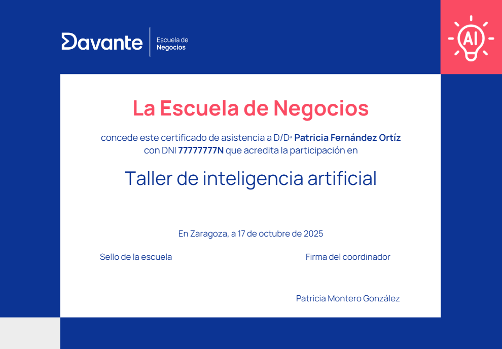

# Curso superior de venta de coches

> **Ficha Técnica del Programa Formativo**
> **Nombre del curso:** Curso superior de venta de coches
> **Código de curso:** 9911
> **Área:** Marketing, Ventas y Gestión Comercial
> **URL oficial:** [https://cambiamostuvida.es/cambiamostuvida/iniBienvenidaAlumno.htm?accion=INFORMACION_CURSO&curso=9911](https://cambiamostuvida.es/cambiamostuvida/iniBienvenidaAlumno.htm?accion=INFORMACION_CURSO&curso=9911)
> **Institución:** Davante | Escuela de Negocios y Marketing

---

## Índice de Contenidos

- [¿Quiénes somos?](#quienes-somos)
- [Presentación](#presentacion)
- [Pruebas Oficiales](#pruebas-oficiales)
- [Duración, horas y temario](#duracion-horas-y-temario)
- [Programa detallado](#programa-detallado)
- [Equipo y colaboradores](#equipo-y-colaboradores)
- [Metodología: lo que nos hace diferentes](#metodologia-lo-que-nos-hace-diferentes)
- [Clases y actividades docentes](#clases-y-actividades-docentes)
- [Prácticas en empresas](#practicas-en-empresas)
- [Casos de éxito](#casos-de-exito)
- [Aval/Diploma/Certificado](#avaldiplomacertificado)
- [Salidas profesionales](#salidas-profesionales)
- [Ventajas para alumnos](#ventajas-para-alumnos)
- [Alumnado internacional](#alumnado-internacional)
- [Talento Davante](#talento-davante)

---

## ¿Quiénes somos?

> ** ¡Hola!**

Antes de nada, queremos presentarnos.

Somos **Davante.** Fruto de la unión entre**Master.D** y **MEDAC,**dos referentes históricos en el sector educativo de España, que han contribuido al desarrollo profesional de **más de 1.000.000 de personas**.**

> **Cifras:**

Estás aquí porque ya nos conoces (aunque sea un poco) y quieres saber más. Por eso, seguro que has oído eso de que **Davante da lo que nadie más te da.** Lo decimos porque estamos convencidos. **No es palabrería,** ni siquiera una frase pegadiza. Estamos seguros de lo que decimos y por eso estamos aquí:**para demostrarlo.**

| ¿Quieres formar parte de una de las escuelas con mejor empleabilidad de España?

 ¿Quieres entrar en uno de los programas premiados como mejor centro educativo para la transformación e innovación digital? |
| --- |

- **Premio de Excelencia Educativa** al mejor programa formativo para la**Inserción Profesional** y Premio de Excelencia Educativa al mejor programa formativo para la**Transformación e Innovación Digital.**

https://tv.masterd.es/contenidos-diseno-imagen-personal

Nuestro objetivo es**formar profesionales del sector** para que adquieran las competencias profesionales adecuadas para**incorporarse al mercado laboral,** bien por cuenta ajena o bien por cuenta propia.

.png)

> Síguenos en **nuestras redes sociales,** para estar al día de todo lo relacionado con tu futuro laboral y**Davante.Pincha en cada una de las imágenes para acceder a nuestras redes sociales**.**

> ** ¿Quieres comprobarlo? Continúa con nosotros.**

---

## Presentación

Somos **socios de GANVAM***(Asociación Nacional de Vendedores de vehículos a motor, reparación y recambios)*

** ¿Qué aprenderás en esta formación?**

- Comprender la**transformación del sector automovilístico** en el ámbito comercial
- Habilidades en **venta online y social selling.**
- Conocimiento las distintas **fases del proceso de venta**
- Fortalecer la**relación con los clientes.**
- Conocer los diferentes **tipos de enfoques** que se pueden aplicar en la**gestión de las ventas, sus características, las peculiaridades, las ventajas y los inconvenientes.**
- Interpretar los diferentes **estilos de comunicación** en función de los**comportamientos verbal y no verbal.**
- Identificar las potencialidades de las diferentes **herramientas y técnicas de venta en línea** y su impacto en la gestión de las ventas.

El **sector de la automoción** está en una etapa de gran transformación. La**digitalización**, el nuevo**cliente omnicanal** y las continuas innovaciones en el sector, han hecho necesaria la búsqueda de un nuevo perfil comercial.

Un nuevo vendedor que promueve una relación continuada con sus clientes, acompañándoles en sus decisiones de compra, que domina las redes sociales, la venta consultiva y la venta relacional.

**Prácticas con los concesionarios de las principales marcas de automóviles**

Para un vendedor de coches, es de vital importancia desarrollar habilidades sociales que posibiliten adquirir un mayor rendimiento en las relaciones con los clientes.

Con el curso **Superior de**Venta de coches** te enseñaremos a manejar la venta emocional a través de las **neuroventas**, adquirirás conocimientos en**social selling**, y todas las competencias que necesitas para ser un vendedor de éxito.

Todo ello a través de nuestro **método**personalizado**,**flexible, pero**exigente** con el cual estarás preparado para insertarte laboralmente o mejorar profesionalmente con unos**resultados por encima de la media.**

Ponemos a tu disposición multitud de herramientas y recursos para alcanzar tu objetivo. **Orientadores, Profesores, Talleres y Masterclass Presenciales, dinámicas de grupo, clases en directo, Video Clases 24 horas, Campus de última generación como verdadera comunidad de aprendizaje, certificaciones oficiales...DOBLE TITULACIÓN: Título propio de la Escuela de Negocios Davante AVALADO por CGAC***(Consejo General de Agentes Comerciales de España)***y Título oficial de agente comercial***(Podrás obtener este diploma a través del CGAC, infórmate de las condiciones)*

Davante / Master.D imparte el **Curso Oficial de Agente Comercial** a nivel***nacional.***

- Se trata del ***Curso Oficial de Acceso a la Profesión***de Agente Comercial Colegiado.
- Este título es ***requisito*** para la colegiación.

A través este curso, los alumnos podrán acceder a la profesión más solicitada por las empresas con la mejor garantía:***el Título Oficial de Agente Comercial Colegiado que expido el Ministerio de Industria, Comercio y Turismo***o a propuesta del Consejo General de Colegios de Agentes Comerciales de España (CGAC).

** ¿Quieres dar un paso más?** Especialízate con nosotros

El mercado cada vez demanda más perfiles enfocados a las nuevas tecnologías,***Davante te ofrece la posibilidad de especializarte***al mismo tiempo que cursas tus estudios, ** ¡elige la tuya!:**

- ***Inteligencia Artificial en marketing digital.***
- ***E-commerce.***
- ***Redes Sociales***
- ***Customer Relationship Management (CRM).***

> ¿A qué esperas? ***Elige tu especialidad y da un salto en tu carrera profesional**.***

Con nuestra especialidad tienes la posibilidad de optar a uno o varios **Certificados de Especialización Universitaria.**

**Consulta condiciones***

Además, podrás **certificarte oficialmente** en**Google Ads y Google Analytics,** y conseguir**certificaciones propias** de**Trello, Canva y Mailchimp, Redes Sociales, Filmora, Hootsuite, Metricool...**

.png)

---

## Pruebas Oficiales

El perfil profesional de esta formación queda determinado por su competencia general, sus competencias profesionales, personales y sociales, por la relación de cualificaciones y, en su caso, **unidades de competencia del Catálogo Nacional de Cualificaciones Profesionales**incluidas en el título.

Cuando termines tu formación con nosotros, podrás acceder al proceso de acreditación de competencias para obtener la **cualificación profesional**correspondiente.

**Este curso está pensado para que puedas acceder a los procesos de acreditación de cualificaciones profesionales de nivel III**:

- COM314_3 - Gestión comercial de ventas

** ¿Qué es una cualificación profesional?**

Una cualificación profesional es un documento **oficial**que **acredita** a un/a trabajador/a en una**cualificación profesional** del Catálogo Nacional de las Cualificaciones Profesionales.

Las Cualificaciones Profesionales se definen como un conjunto de competencias profesionales adquiridas a través de la experiencia laboral acreditada y a través de la formación ocupacional o reglada. Cada una de estas competencias está asociada a un módulo formativo. Una vez conseguida el conjunto de competencias de una Cualificación Profesional, un sujeto obtendrá el certificado profesional correspondiente a dicha cualificación.

Está recogido a[**nivel europeo**](https://europa.eu/europass/es/learn-europe/certificate-supplement) en el MEC (Marco Europeo de Cualificaciones) para la educación superior, que facilita el acceso al mercado laboral en toda Europa e impulsar la movilidad transfronteriza.

.png)

Ejemplo de documento oficial acreditativo de cualificaciones profesionales. Puede diferir el formato en función de la comunidad autónoma.

** ¿Qué más utilidades tienen las cualificaciones profesionales?**

Efectos acumulables: te permiten seguir estudiando e incluso llegar a conseguir un **Título de Formación Profesional.**

Si cumples los requisitos acceso Grado Medio y Grado Superior, podrás convalidar módulos profesionales y superar los restantes hasta finalizarlo.

¡Recuerda! Para obtener una Cualificación oficial en España, la ley exige que se cumplan los siguientes requisitos:

Necesitarás:

- Nacionalidad española, certificado de registro de ciudadanía comunitaria o tarjeta de familiar de ciudadano o ciudadana de la Unión, o ser titular de una autorización de residencia o de residencia y trabajo en España en vigor, en los términos establecidos en la normativa española de extranjería e inmigración. Excepcionalmente, podrán iniciarse procedimientos específicos para colectivos que no cumplan este requisito, siempre que esté vinculado a acuerdos internacionales o a planes estratégicos para la cobertura de las necesidades profesionales de determinados sectores productivos.
- Edad:

20 años cumplidos (nivel III)

18 años cumplidos (nivel II)

** ¿No cumples requisitos en este momento?**

¡No pasa nada! Tienes un plazo de 10 años para poder certificar tus conocimientos.

---

## Duración, horas y temario

> **Duración y horas.**

La duración del curso es de**450 horas** y dispondrás de un periodo máximo de**18 meses** a partir de la fecha de matriculación para completar este programa formativo.

Además, podrás enriquecer tu formación con hasta 300 horas de prácticas profesionales voluntarias en empresas del sector, una excelente oportunidad para tomar la iniciativa y comenzar a abrirte camino en el entorno laboral.

Si te decides por cursar una **<u>especialidad</u>,** con una duración total de**550 horas** en un tiempo máximo de**24 meses.**

> **Temario de tu curso.**

Las asignaturas de este programa son las siguientes:

- Introducción a la venta de coches
- Venta y negociación
- Programación Neurolingüística
- La relación con el cliente
- Social Selling
- Tecnología del automóvil
- Servicios asociados y de posventa en el concesionario
- Inteligencia emocional y liderazgo en ventas
- Trabajo fin de curso

** ¿Quieres dar un paso más?** Especialízate con nosotros.

El mercado cada vez demanda más perfiles enfocados a las nuevas tecnologías, ***Davante te ofrece la posibilidad de especializarte***al mismo tiempo que cursas tus estudios, ** ¡elige la tuya!:**

- ***Inteligencia Artificial en marketing digital.***
- ***E-commerce.***
- ***Redes Sociales***
- ***Customer Relationship Management (CRM).***

> ¿A qué esperas? ***Elige una especialidad y da un salto en tu carrera profesional**.**

Con nuestra especialidad tienes la posibilidad de optar a uno o varios **Certificados de Especialización Universitaria.**

---

## Programa detallado

**1. Introducción a la venta de coches.**

- El sector de la automoción.
- Sociología del automóvil.

**2. Venta y negociación.**

- Conocimiento del cliente / consumidor.
- La comunicación en ventas.
- La comunicación comercial no presencial.
- Las herramientas de ventas.
- Las etapas de la venta.
- La negociación en ventas.
- Las objeciones.

**3. Programación Neurolingüística.**

- PNL y comunicación.
- Sistemas representacionales en ventas.
- Cómo sintonizar más con nuestros clientes.
- Aprender a usar el lenguaje para generar mejores resultados.
- Cómo incrementar el impacto de nuestras relaciones comerciales.

**4. La relación con el cliente.**

- Estrategia de relación con el cliente.
- Expectativas y satisfacción del cliente.
- Gestión de la experiencia de cliente.
- Gestión de reclamaciones y quejas.

**5. Social Selling.**

- Introducción al Social Selling.
- Estrategia y plan de acción.
- Herramientas de gestión.
- La reputación online.
- Medición y tendencias.
- El blog.

**6. Tecnología del automóvil.**

- El motor.
- Vehículo eléctrico.
- Transmisión, suspensión, dirección, frenos y neumáticos.
- Electricidad y electrónica.
- Chasis y carrocería.
- Sistemas de seguridad y confort.

**7. Servicios asociados y de posventa en el concesionario.**

- Gestoría.
- Financiación.
- Seguro.
- Servicio posventa.

**8. Inteligencia emocional y liderazgo en ventas.**

- La inteligencia emocional en ventas.
- Gestión de la ansiedad y el estrés.
- Resiliencia y tolerancia a la frustración.
- Mindfulness para lograr el equilibrio.

**9. Trabajo Final de Curso.**

- Elaboración de un argumentario para la venta de un vehículo.

---

## Equipo y colaboradores

En la **Escuela de Negocios Davante** ponemos a tu disposición un**equipo docente** con experiencia en el sector que te ayudarán a que consigas tu objetivo.

> ** ¿Quieres conocerlos?**

🔗 **Recurso interactivo:** [Vídeo explicativo](https://www.escuelanegociosdavante.es/equipo)

Además, colaboramos con un **equipo de expertos en activo** que te transmitirán toda su experiencia y conocimiento a través de diferentes actividades.

---

## Metodología: lo que nos hace diferentes

**Desde el primer día,** el método Davante te ofrece una**preparación única:**

- **Innovadora, práctica, personalizada** y, lo más importante, centrada en tu**empleabilidad.**

---

## Clases y actividades docentes

> **Clases en directo y videoclases.**

Tendrás la posibilidad de acceder a **clases *on-line,*** a través del Campus Virtual, en las que te explicaremos materias de tu curso, te enseñaremos técnicas de estudio, consejos y todo lo que necesites.

Te ofrecemos varios tipos de clases:

- **<u>Clases en directo</u>:** en ellas puedes**interactuar con el profesor,**con tus compañeros,** preguntar**en directo** las dudas que te vayan surgiendo.Además, como **quedan grabadas,** puedes volver a verlas todas las veces que quieras.
- **<u>Videoclases 24 horas</u>:** son clases**grabadas** impartidas por expertos, por lo que puedes verlas sin tener que desplazarte, de una forma sencilla a través de tu**ordenador, *tablet* o móvil.**

https://tv.masterd.es/marketing-para-principiantes

> **Eventos, *masterclasses,* clases temáticas.**

Ya te hemos dicho que damos lo que nadie más te da. Nos referimos, entre otras cosas, a talleres, seminarios, eventos, programas en nuestra televisión educativa e incluso algún pódcast (sí, es cierto: **tenemos una televisión y una radio propias** ).

https://tv.masterd.es/eventos-marketing-ventas

Además, dentro de estos talleres podrás obtener**6 diplomas adicionales en herramientas de**INTELIGENCIA ARTIFICIAL**,** poniendo en práctica habilidades necesarias para mejorar tu empleabilidad:

- Mejora tu perfil profesional en LinkedIn con IA
- Crea tu contenido en redes sociales con IA
- Crea presentaciones de tus productos con IA
- Crea tu página web con IA
- Crea tu porfolio con IA
- Crea tu videocurrículum con IA

Todos los meses habrá un taller de Inteligencia artificial en tu centro.

> **Expertos colaboradores.**

Además, entre **nuestros expertos colaboradores** contamos con prestigiosos profesionales en activo.

> ** ¿Y si te has perdido el taller o no estás en la ciudad donde se imparte?**

No pasa nada, lo tenemos todo previsto y ensayado. Podrás visualizarlo **en directo a distancia** o verlo grabado**cuando y donde quieras.**

---

## Prácticas en empresas

Como grupo educativo, colaboramos más de **6.000 empresas**,** entre las cuales se encuentran las mejores empresas de cada sector. Con este curso podrás optar a la realización de tus **prácticas en empresas** que te ayudarán a consolidar los conocimientos que vas a adquirir.

En el sector del automóvil tenemos convenios de prácticas con los concesionarios de las principales marcas. Aquí puedes ver algunas de las empresas que colaboran con nosotros en distintas localidades:

.jpg)

---

## Casos de éxito

> Lo que vas a ver a continuación es la prueba de que **los sueños se cumplen.** Pero ten en cuenta que tendrás que poner**toda tu pasión y todo tu esfuerzo.** Lo mejor es que te lo cuenten**personas que, como tú, confiaron en nosotros.**

No te pierdas **opiniones, consejos e historias** de su camino hasta el éxito. Si quieres ver testimonios reales de alumnado de**todas nuestras áreas formativas,** anímate y**dale al *play.**🔗 **Recurso interactivo:** [Vídeo explicativo](https://tv.masterd.es/opiniones-marketing-ventas)***

---

## Aval/Diploma/Certificado

Después de superar con éxito los contenidos de tu programa, recibirás el título propio de **Davante | Escuela de Negocios:**

Si decides especializarte, podrás optar a un certificado de **curso universitario de especialización,** acreditado por la**Universidad de Vitoria-Gasteiz:**

En los **talleres de Inteligencia artificial** recibirás un total de 6 diplomas por cada uno que realices**.**

Como te adelantábamos al principio, **damos lo que nadie más te da.** Por eso, podrás conseguir**un diploma por cada competencia** que completes en nuestro sistema**Fundamentos 360.**

> **Espera, todavía hay más.**

Además, podrás **certificarte oficialmente** en**Google Ads y Google Analytics,** y conseguir**certificaciones propias** de**Trello, Canva y Mailchimp, Redes Sociales, Filmora, Hootsuite, Metricool...**

.png)

---

## Salidas profesionales

El campo en el que te podrás desarrollar profesionalmente con el **Curso Superior de Venta de coches** es muy amplio.

> **Ocupaciones o puestos de trabajo relacionados**

- Vendedor en concesionarios.
- Jefe de ventas
- Jefe de departamento
- Director de concesionario
- Propietario de concesionario
- Representante de marca

> **Salario**

- **Vendedor de coches:** 25.000 a 40.000 euros (33.000 euros sueldo medio).

> ** ¿Y para ello que ponemos en tu mano?**

Davante da lo que nade más te da: la oportunidad de **triunfar en el mundo laboral con TALENTO DAVANTE.**

---

## Ventajas para alumnos

**Curso "Avalado" porCGAC (*Consejo General de Agentes Comerciales de España* )**

**DOBLE TITULACIÓN: Título propio de la Escuela de Negocios Davante AVALADO por CGAC***(Consejo General de Agentes Comerciales de España)***y Título oficial de agente comercial***(Podrás obtener este diploma a través del CGAC, infórmate de las condiciones)*

Davante imparte el **Curso Oficial de Agente Comercial** a nivel***nacional.***

- Se trata del ***Curso Oficial de Acceso a la Profesión*** de Agente Comercial Colegiado.
- Este título es ***requisito*** para la colegiación.

A través este curso, los alumnos podrán acceder a la profesión más solicitada por las empresas con la mejor garantía:***el Título Oficial de Agente Comercial Colegiado que expido el Ministerio de Industria, Comercio y Turismo***o a propuesta del Consejo General de Colegios de Agentes Comerciales de España (CGAC).

Con este curso podrás **certificarte oficialmente** en**Google Ads y Google Analytics,** y conseguir**certificaciones propias** de**Trello, Canva y Mailchimp, Redes Sociales, Filmora, Hootsuite, Metricool...**

.png)

Somos **socios de GANVAM***(Asociación Nacional de Vendedores de vehículos a motor, reparación y recambios)*

Además, por ser alumno/a de la escuela dispondrás del CRM **de ODOO¿Tienes un proyecto en la cabeza? ¿Quieres montar un negocio o empresa?** Como alumno de la escuela te ofrecemos de forma totalmente gratuita nuestro**Servicio de asesoramiento para emprendedores**. Te ayudamos a desarrollar tu idea y darle forma.

Además, si lo deseas podrás disponer de servicio de **inglés**de forma voluntaria y manera gratuita con el curso (en alguno de estos niveles A2, B1, B2, C1).

Posibilidad de bonificar por **FUNDAE** para trabajadores en activo.

(consulta a tu asesor)

---

## Alumnado internacional

> > **Estudiar desde el extranjero.**

Para **Davante,** tienen la consideración de**alumnado internacional** todas las personas que soliciten cursar con nosotros una formación a distancia cuya**residencia esté fuera del territorio español, sea cual sea su nacionalidad.**

En **Davante** formamos a estudiantes de todos los lugares del mundo, ya que nuestra preparación está adaptada para que**cualquier persona, esté donde esté,** obtenga las habilidades suficientes para**entrar en el mercado laboral.Un dato:** más de 3.000 alumnos internacionales han confiado en nosotros para poder formarse y cumplir sus metas.

En España y Portugal somos **líderes en el sector de la formación abierta,** mientras que**en el resto del mundo** somos el**mayor centro de referencia** que tienen los hispanohablantes para poder formarse en su lengua. Como te decíamos, la calidad de nuestra formación está avalada y contrastada con**sellos de calidad** como EFQM.

> ***Cada vez somos más.***

Por un lado, hay una necesidad creciente de formación para profesionalizarse o conseguir un trabajo para toda la vida; por otro, en **Davante** somos**especialistas en formación a distancia.** A cualquier distancia.

**Otro dato:** en los últimos años, el porcentaje de alumnado internacional que ha crecido un 60%.

Hay miles de personas, de **más de 100 países,** que diariamente se conectan y siguen sus estudios con nosotros. **Suiza, Reino Unido, México, Alemania, Italia** o**Francia** son algunos de los países en los que nuestro alumnado recibe formación.

Hoy por hoy, **más de 2.500 alumnos**se encuentran en otros países.

> **No hay distancia que nos separe.**

Si decides continuar con nosotros, tendrás **acceso a todos los servicios** que ofrecemos.

Si quieres recibir una **formación de calidad, contrastada y avalada** por un centro de formación con más de 30 años de experiencia, estamos aquí para ayudarte. Hoy en día no existen fronteras para el saber ni para la formación. En**Davante** lo sabemos y por eso llevamos**desde 1994** manejando**tecnología de vanguardia,** siendo**líderes absolutos en formación abierta.**

Si quieres, estaremos cerca de ti, aunque nos separen miles de kilómetros. Podemos asegurarlo porque pondremos a tu disposición un campus virtual de última generación, una televisión educativa propia, contenido actualizado constantemente, tutorías *on-line,* servicio de orientación, talleres*on-line* de habilidades... Todo ello de forma**flexible y adaptada a tus necesidades.**

> **Todo esto y mucho más.**

Trabajamos diariamente para que no notes los miles de kilómetros que nos separan, pero también para poner a tu disposición nuevos servicios. Nos enorgullecemos de escuchar a nuestro alumnado y de darle lo que necesita para que alcance sus metas. Por eso, no solo ponemos toda nuestra tecnología a tu servicio, **te damos lo que nadie más te da.**

Tenemos **tanto que ofrecerte** que, para finalizar,**te dejamos <u>un resumen</u>:**

- Ponemos a tu alcance el material del curso, estés donde estés, siempre actualizado.
- Impartimos clases en directo a través de nuestro campus virtual (además, quedan grabadas, así que podrás verlas cuando y donde quieras).
- Contenidos impartidos por el equipo docente, tus profesores y profesoras, que son quienes mejor conocen lo que debes aprender.
- Habilidades u orientación académica y laboral: nuestro equipo de orientadores te ayudará a entrenar las habilidades necesarias para lograr tus objetivos. También pondrá a tu alcance todas las herramientas que necesites para triunfar en el mundo laboral.
- Emitimos para todo el mundo talleres, seminarios, charlas con expertos, *masterclasses,* etcétera, a los que puedes conectarte en tiempo real (en horario de España), preguntar dudas, compartir inquietudes con otros alumnos y, por supuesto, todo queda grabado para que no te pierdas nada.
- Puedes cambiar tu condición de alumno/a internacional en cualquier momento (si llega el momento, pregúntanos y te informaremos).
- Nuestros diplomas se emiten en varios idiomas (inglés, francés, alemán, italiano, etcétera).
- Si necesitas un certificado de matriculación o finalización de tu formación, tan solo tienes que solicitarlo.
- Módulos complementarios de los idiomas inglés, español y francés.
- Además, si lo deseas, podrás solicitar que apostillemos tu diploma notarialmente mediante la Apostilla de La Haya. Gracias a ello podrás certificar la autenticidad de nuestro diploma.

> ** ¿Sabes qué es la Apostilla de la Haya?**

Puedes consultar toda la información haciendo clic en **[este enlace](https://www.hcch.net/es/instruments/specialised-sections/apostille/).**

Y aquí tienes un ejemplo:

> ** ¿Qué opinan de nosotros?**

Te invitamos a que eches un vistazo a lo que nuestro alumnado internacional opina de nosotros. Estamos muy orgullosos de lo que han conseguido.

🔗 **Recurso interactivo:** [Vídeo explicativo](https://www.opinionesmasterd.es/internacional)

---

## Talento Davante

Ya estamos terminando y queremos volver a lo que te decíamos al principio.

** ¿Recuerdas aquello de que te damos más que nadie? Pues nos reafirmamos**.**

Davante da lo que nade más te da: la oportunidad de **<u>triunfar en el mundo laboral</u>.**

Para acompañarte a construir tu trayectoria profesional, ponemos a tu disposición <u>tres herramientas fundamentales</u>:**Davante Empleo, Davante**Emprende** y**Davante x InfoJobs.**

Te lo contamos ahora mismo.

> **Davante empleo.**

Es un servicio exclusivo diseñado para apoyarte en tu inserción y desarrollo profesional, desde el que accederás a todo esto:

- **Ofertas de trabajo exclusivas para alumnado Davante,** tanto de la red Jobteaser, como propias. Más de 30.000 ofertas disponibles.
- Acceso al **listado de empresas** con las que tenemos acuerdos para ofrecerte ofertas de empleo (estas vacantes y las anteriores<u>**no aparecen en otros buscadores de empleo**</u> ).
- **Eventos profesionales** de todos los sectores y en todos los formatos, donde podrás conocer y hacer*networking* con empresas de tu sector. ¡No te los puedes perder!
- **Consejos de empleabilidad** muy útiles para acceder al mercado laboral.
- **Recursos Davante:** portales de empleo, orientación laboral, emprendimiento, salidas profesionales...

> **Davante Emprende.**

Si tienes una **idea de negocio** y quieres llevarla al siguiente nivel montando**tu propia empresa,** esta es tu oportunidad. A través de un programa en tres fases, recibirás**formación, mentoría, recursos clave** y**premios** para poner en marcha tu negocio.

https://www.youtube.com/watch?v=q1osFN1qgRg

> **Davante x Infojobs.**

¿Conoces InfoJobs? Si has buscado o estás buscando trabajo, seguro que sí. Es el portal de empleo de referencia nacional. En Davante, solamente **nos asociamos con los mejores.** Por eso, InfoJobs ha creado esta web donde se aglutinan**todas las ofertas publicadas en la plataforma,** organizadas por los sectores afines a tus estudios para que tus búsquedas sean más fáciles.

Lo mejor es que la veas y le eches un vistazo.

🔗 **Recurso interactivo:** [Vídeo explicativo](https://davante.infojobs.net/)
