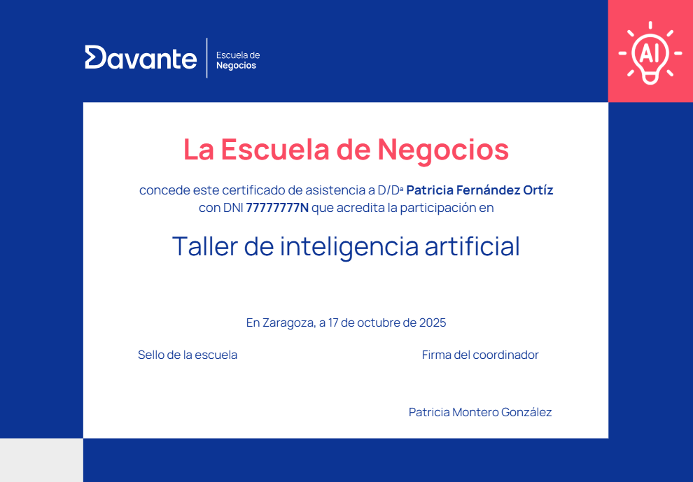

# Curso superior de visitador médico y parafarmacéutico

> **Ficha Técnica del Programa Formativo**
> **Nombre del curso:** Curso superior de visitador médico y parafarmacéutico
> **Código de curso:** 14891
> **Área:** Marketing, Ventas y Gestión Comercial
> **URL oficial:** [https://cambiamostuvida.es/cambiamostuvida/iniBienvenidaAlumno.htm?accion=INFORMACION_CURSO&curso=14891](https://cambiamostuvida.es/cambiamostuvida/iniBienvenidaAlumno.htm?accion=INFORMACION_CURSO&curso=14891)
> **Institución:** Davante | Escuela de Negocios y Marketing

---

## Índice de Contenidos

- [¿Quiénes somos?](#quienes-somos)
- [Presentación](#presentacion)
- [Duración, horas y programa](#duracion-horas-y-programa)
- [Programa detallado](#programa-detallado)
- [Equipo y colaboradores](#equipo-y-colaboradores)
- [Metodología: lo que nos hace diferentes](#metodologia-lo-que-nos-hace-diferentes)
- [Clases y actividades docentes](#clases-y-actividades-docentes)
- [Prácticas en empresas](#practicas-en-empresas)
- [Casos de éxito](#casos-de-exito)
- [Aval/Diploma/Certificado](#avaldiplomacertificado)
- [Salidas profesionales](#salidas-profesionales)
- [Ventajas para alumnos](#ventajas-para-alumnos)
- [Alumnado internacional](#alumnado-internacional)
- [Talento Davante](#talento-davante)

---

## ¿Quiénes somos?

> ** ¡Hola!**

Antes de nada, queremos presentarnos.

Somos **Davante.** Fruto de la unión entre**Master.D** y **MEDAC,**dos referentes históricos en el sector educativo de España, que han contribuido al desarrollo profesional de **más de 1.000.000 de personas**.**

> **Cifras:**

Estás aquí porque ya nos conoces (aunque sea un poco) y quieres saber más. Por eso, seguro que has oído eso de que **Davante da lo que nadie más te da.** Lo decimos porque estamos convencidos. **No es palabrería,** ni siquiera una frase pegadiza. Estamos seguros de lo que decimos y por eso estamos aquí:**para demostrarlo.**

| ¿Quieres formar parte de una de las escuelas con mejor empleabilidad de España?

 ¿Quieres entrar en uno de los programas premiados como mejor centro educativo para la transformación e innovación digital? |
| --- |

- **Premio de Excelencia Educativa** al mejor programa formativo para la**Inserción Profesional** y Premio de Excelencia Educativa al mejor programa formativo para la**Transformación e Innovación Digital.**

https://tv.masterd.es/contenidos-diseno-imagen-personal

Nuestro objetivo es**formar profesionales del sector** para que adquieran las competencias profesionales adecuadas para**incorporarse al mercado laboral,** bien por cuenta ajena o bien por cuenta propia.

.png)

> Síguenos en **nuestras redes sociales,** para estar al día de todo lo relacionado con tu futuro laboral y**Davante.Pincha en cada una de las imágenes para acceder a nuestras redes sociales**.**

> ** ¿Quieres comprobarlo? Continúa con nosotros.**

---

## Presentación

El **sector farmacéutico y de parafarmacia** cada vez tiene más importancia en nuestro país. Y, al mismo tiempo, está viviendo una gran**transformación digital**, con una gran presencia de la venta online.

Las farmacias ya no solo expiden medicamentos, sino que se han convertido en **centros** donde se comercializan múltiples productos que tienen como denominador común el**cuidado personal de forma integral**.

Al mismo tiempo, cada vez son más frecuentes las secciones de parafarmacia en los centros comerciales. Todo ello motivado por una mayor **preocupación social por lo saludable**, junto con la mayor aceptación de la**farmacia alternativa**.

En este contexto, el visitador médico y parafarmacéutico supone una pieza clave para los laboratorios farmacéuticos, ya que es el profesional que **informa**,**promociona** y**forma** sobre los medicamentos y demás productos de parafarmacia, sus características, resultados y ventajas frente a los productos de la competencia.

Con el **curso superior de visitador médico y parafarmacéutico** te convertirás en**el profesional que están demandando** las empresas farmacéuticas y de parafarmacia. Un profesional que domina la**venta técnica** y las nuevas herramientas comerciales:**social selling**,**neuromarketing**, etc.

** ¿Qué aprenderás en esta formación?**

- Entender la **transformación digital** del sector de farmacia y para farmacia.
- **Planificar y realizar las visitas** a los clientes.
- Desarrollar, promover y mantener la **relación de la industria farmacéutica con médicos/as y farmacéuticos/as**.
- Conocer y dominar las distintas **fases del proceso de venta**.
- Manejar la **venta social** (Social Selling)
- Dominar las técnicas de **neuromarketing**.
- Fortalecer la **relación con los clientes**.
- Identificar las potencialidades de las diferentes **herramientas y técnicas de venta en línea** y su impacto en la gestión de las ventas.
- Adquirir **conocimientos** en**patologías**,**medicamentos** y**productos parafarmacéuticos**.
- Gestionar y promocionar la **cartera de productos farmacéuticos y parafarmacéuticos** que te hayan asignado.

Ponemos a tu disposición multitud de herramientas y recursos para alcanzar tu objetivo. **Orientadores, Profesores, Talleres y Masterclass, dinámicas de grupo, clases en directo, Video Clases 24 horas, Campus de última generación como verdadera comunidad de aprendizaje, certificaciones oficiales...DOBLE TITULACIÓN: Título propio de la Escuela de Negocios Davante AVALADO por CGAC***(Consejo General de Agentes Comerciales de España)***y Título oficial de agente comercial***(Podrás obtener este diploma a través del CGAC, infórmate de las condiciones).*

Davante imparte el **Curso Oficial de Agente Comercial** a nivel***nacional.***

- Se trata del ***Curso Oficial de Acceso a la Profesión***de Agente Comercial Colegiado.
- Este título es ***requisito*** para la colegiación.

A través este curso, los alumnos podrán acceder a la profesión más solicitada por las empresas con la mejor garantía:***el Título Oficial de Agente Comercial Colegiado que expido el Ministerio de Industria, Comercio y Turismo***o a propuesta del Consejo General de Colegios de Agentes Comerciales de España (CGAC).

** ¿Quieres dar un paso más?** Especialízate con nosotros.

El mercado cada vez demanda más perfiles enfocados a las nuevas tecnologías,***Davante te ofrece la posibilidad de especializarte***al mismo tiempo que cursas tus estudios, ** ¡elige la tuya!:**

- ***Inteligencia Artificial en marketing digital.***
- ***E-commerce**.***
- ***Redes Sociales.***

> ¿A qué esperas? ***Elige tu especialidad y da un salto en tu carrera profesional**.***

Con nuestra especialidad tienes la posibilidad de optar a uno o varios **Certificados de Especialización Universitaria.**

**Consulta condiciones***

Además, podrás **certificarte oficialmente** en**Google Ads y Google Analytics,** y conseguir**certificaciones propias** de**Trello, Canva y Mailchimp, Redes Sociales, Filmora, Hootsuite, Metricool...**

.png)

---

## Duración, horas y programa

> **Duración y horas**

La duración del curso es de**400 horas** y dispondrás de un periodo máximo de**18 meses** a partir de la fecha de matriculación para completar este programa formativo.

Además, podrás enriquecer tu formación con hasta 300 horas de prácticas profesionales voluntarias en empresas del sector, una excelente oportunidad para tomar la iniciativa y comenzar a abrirte camino en el entorno laboral.

Si te decides por cursar una **<u>especialidad</u>,** con una duración total de**500 horas** en un tiempo máximo de**24 meses.**

> **Temario de tu curso**

Las asignaturas de este programa son las siguientes:

- Organización de la actividad del vendedor técnico.
- Realización de actividades de venta técnica.
- Social Selling.
- El laboratorio farmacéutico y la industria farmacéutica.
- Anatomía patologías básicas del cuerpo humano.
- Venta de productos de parafarmacia.
- Trabajo final de curso.

** ¿Quieres dar un paso más?** Especialízate con nosotros

El mercado cada vez demanda más perfiles enfocados a las nuevas tecnologías, ***Davante te ofrece la posibilidad de especializarte***al mismo tiempo que cursas tus estudios, ** ¡elige la tuya!:**

- ***Inteligencia Artificial en marketing digital.***
- ***E-commerce**.***
- ***Redes Sociales.***

> ¿A qué esperas? ***Elige una especialidad y da un salto en tu carrera profesional**.**

Con nuestra especialidad tienes la posibilidad de optar a uno o varios **Certificados de Especialización Universitaria.**

---

## Programa detallado

#### **1. Organización de la actividad del vendedor técnico.**

- **Marco jurídico de la actividad de un equipo de ventas.**

- La actividad de vendedor.
- Representantes de comercio.
- Remuneración de los vendedores.
- Elementos de fiscalidad aplicables a la profesión de representante.
- Empresario individual o autónomo.
- **Organización de la actividad.**

- Organización de las rutas de visita.
- Preparación de la documentación profesional.
- Instrumentos que facilitan la realización de la entrevista de ventas.
- Planificación de la venta.
- Preparación para la entrevista.
- Preparación del primer contacto.
- Preparación de la visita de ventas.
- **La visita médica.**

- La visita médica
- Materiales de apoyo de la visita médica
- Lugar de realización de la visita médica
- **Gestión de la actividad.**

- Gestión del tiempo
- Productividad del sector
- Costes por vendedor
- Optimización de la actividad

#### **2. Realización de actividades de venta técnica.**

- **El vendedor.**

- Funciones básicas de la venta personal.
- Tareas del vendedor.
- Rasgos de personalidad.
- Características físicas.
- La voz y el lenguaje.
- Los modales.
- Factores intelectuales.
- Dotes verbales.
- Pensamiento creativo.
- Edad, estudios y experiencia.
- El comprador.
- **Comunicación.**

- Elementos de la comunicación.
- Proceso de comunicación.
- La política de comunicación.
- Canales de comunicación.
- La comunicación en la venta personal.
- Funciones del mensaje.
- Obstáculos a la comunicación.
- Las herramientas de la comunicación en ventas.
- La escucha activa.
- La comunicación no verbal.
- La observación.
- Las preguntas.
- La improvisación.
- La persuasión.
- **Metodología de conocimiento del producto.**

- El producto dentro del proceso de venta.
- Componentes de un producto.
- El producto ampliado.
- Seguimiento de los productos vendidos.
- Conocimiento del producto.
- La competencia.
- ¿cómo darle al cliente, justo el producto que necesita?
- Marketing y producto.
- **Metodología de conocimiento del cliente.**

- Métodos para medir la satisfacción del cliente.
- Las necesidades y expectativas de los clientes.
- **La venta y la negociación.**

- La venta.
- La negociación.
- El perfil del negociador.
- Preparar la negociación.
- La documentación.
- El estado anímico.
- Material de apoyo.
- Fases del proceso de venta.
- Situaciones difíciles
- Posibles obstáculos a la negociación.
- Suspensión de la venta.
- Métodos de ventas.
- **Seguimiento de la venta.**

- La garantía y servicios posventa.
- Responsabilidad civil por bienes o servicios defectuosos.
- **Marco jurídico de la venta.**

- Contratos y responsabilidad contractual.
- El contrato de compraventa mercantil.
- Protección y defensa del consumidor.
- Disposiciones relativas a la competencia.

#### **3. Social Selling.**

- **Introducción al Social Selling.**

- Un nuevo paradigma en el proceso de ventas.
- Entendiendo el social selling.
- Los fundamentales en tu estrategia de social selling.
- Estrategia de social selling con LinkedIn.
- **Estrategia y plan de acción.**

- Análisis de la situación.
- Objetivos.
- Segmentación.
- Estrategia y plan de acción.
- Análisis de resultados.
- **Herramientas de gestión.**

- Evolución de las redes sociales.
- Categorización de herramientas.
- Principales herramientas al detalle.
- **Reputación on-line.**

- Reputación.
- Crisis de reputación.
- Pasos para resolver una crisis.
- Pasos para evitar una crisis.
- **Medición y tendencias.**

- El valor del dato.
- Plan de medición para social media.
- Implementación de la medición con Google Analytics.
- Visualización de la información.
- Tendencias en social media.
- **El blog.**

- Historia y definición.
- Tipos de blog.
- Plataformas de creación.
- La importancia del SEO.
- Anatomía de un blog.
- Estrategia de contenidos.

#### **4. El laboratorio farmacéutico y la industria farmacéutica.**

- **Qué es un laboratorio farmacéutico.**

- La unidad científica.
- La unidad comercial.
- El vademécum.
- Los laboratorios.
- **Imagen y respuesta de la industria farmacéutica.**

- Imagen de empresa.
- Imagen de la industria farmacéutica.
- Respuestas de la industria farmacéutica.
- **Los medicamentos.**

- Conceptos básicos.
- Factores que modifican la respuesta a los medicamentos.
- Clasificación de los medicamentos.
- Formas de presentación.
- Precauciones previas a la administración de fármacos.
- Vías de administración.

#### **5. Anatomía y patologías básicas del cuerpo humano.**

- **Organización general del cuerpo humano**.

- Análisis de la estructura jerárquica del organismo.
- Estudio de la célula.
- Estudio de los tejidos.
- Clasificación de los sistemas y aparatos del organismo.
- Localización de las estructuras anatómica.
- **Aspectos generales de las patologías humanas.**

- Valoración de salud y enfermedad.
- Análisis de la etiología, la patogenia, la fisiopatología y la semiología.
- Fases y evolución de la enfermedad.
- Incidencias en el curso de la enfermedad.
- Clínica de la enfermedad.
- **El sistema nervioso y los órganos de los sentidos.**

- El sistema nervioso.
- Los órganos de los sentidos.
- Patologías del sistema nervioso.
- Enfermedades de los órganos de los sentidos.
- **El aparato locomotor.**

- El sistema esquelético.
- Estudio de las articulaciones y los movimientos articulares.
- Los músculos y la actividad motora.
- Enfermedades óseas.
- Enfermedades articulares.
- Enfermedades del músculo.
- **El aparato cardiocirculatorio.**

- Bases anatomofisiológicas del corazón.
- Principales vasos sanguíneos y linfáticos.
- La circulación arterial y venosa.
- Parámetros funcionales del corazón y la circulación
- Patologías cardiacas y vasculares.
- **El aparato respiratorio y la sangre.**

- Anatomía del aparato respiratorio.
- Fisiología de la respiración.
- Patológicas y enfermedades respiratorias.
- La sangre.
- Clasificación de los trastornos sanguíneos.
- **El aparato digestivo.**

- Anatomía del aparato digestivo.
- Análisis del proceso de digestión y el metabolismo.
- Manifestaciones patológicas del aparato digestivo.
- Enfermedades del aparato digestivo.
- **El aparato excretor.**

- Los riñones y el proceso urinario.
- El proceso de formación de la orina.
- Manifestaciones patológicas.
- Patología renal y urinaria.
- **El sistema endocrino.**

- El sistema endocrino.
- Los órganos endocrinos.
- Funcionamiento del sistema endocrino.
- Patología endocrina.
- **El aparato genital y el sistema inmunológico.**

- El aparato genital femenino y masculino.
- La reproducción humana.
- Patológicas y enfermedades del aparato genital.
- El sistema inmunológico.
- Clasificación de las alteraciones del sistema inmunitario.

#### **6. Venta de productos de parafarmacia.**

- **Los productos de parafarmacia.**

- Los productos de parafarmacia.
- Clasificación de los productos de parafarmacia.
- Dispensación y venta de productos de parafarmacia.
- Etiquetado de los productos de parafarmacia.
- Fuentes de información.
- **Productos sanitarios y biocidas.**

- Los productos sanitarios.
- Material de cura y sutura.
- Materiales para la inmovilización.
- Insuficiencia venosa.
- Incontinencia urinaria.
- Anticonceptivos y productos ginecológicos.
- Test de embarazo.
- Medición de la temperatura.
- Medición de la presión arterial.
- Autocontrol de la diabetes.
- Sistemas de inyección: jeringas y agujas.
- Dispositivos para la ventiloterapia.
- Sondas, catéteres y cánulas.
- Ostomías.
- Productos biocidas.
- **Nutrición, dietética e higiene bucodental.**

- Alimentación y nutrición.
- Dieta mediterránea.
- Valores somatométricos.
- Productos dietéticos.
- Consejo nutricional.
- Higiene bucodental.
- **Cosmética y dermofarmacia.**

- La piel.
- Cosmética facial.
- Cosmética corporal.
- El cabello.
- Las uñas y las glándulas sudoríparas.
- Cosmética decorativa.
- Cosmetovigilancia.
- Cosmética solar.
- Afecciones producidas por la radiación solar.
- **Puericultura y nutrición infantil.**

- Puericultura en farmacia y parafarmacia.
- Nutrición infantil. El lactante.
- La leche de fórmula.
- La alimentación complementaria.
- Cosmética infantil.
- Alteraciones patológicas frecuentes del bebé.
- **Ortopedia, óptica y audioprótesis.**

- Ortopedia.
- Óptica.
- Audioprótesis.

#### **7. Trabajo final del curso.**

---

## Equipo y colaboradores

En la **Escuela de Negocios Davante** ponemos a tu disposición un**equipo docente** con experiencia en el sector que te ayudarán a que consigas tu objetivo.

> ** ¿Quieres conocerlos?**

🔗 **Recurso interactivo:** [Vídeo explicativo](https://www.escuelanegociosdavante.es/equipo)

Además, colaboramos con un **equipo de expertos en activo** que te transmitirán toda su experiencia y conocimiento a través de diferentes actividades.

---

## Metodología: lo que nos hace diferentes

**Desde el primer día,** el método Davante te ofrece una**preparación única:**

- **Innovadora, práctica, personalizada** y, lo más importante, centrada en tu**empleabilidad.**

---

## Clases y actividades docentes

> **Clases en directo y videoclases.**

Tendrás la posibilidad de acceder a **clases *on-line,*** a través del Campus Virtual, en las que te explicaremos materias de tu curso, te enseñaremos técnicas de estudio, consejos y todo lo que necesites.

Te ofrecemos varios tipos de clases:

- **<u>Clases en directo</u>:** en ellas puedes**interactuar con el profesor,**con tus compañeros,** preguntar**en directo** las dudas que te vayan surgiendo.Además, como **quedan grabadas,** puedes volver a verlas todas las veces que quieras.
- **<u>Videoclases 24 horas</u>:** son clases**grabadas** impartidas por expertos, por lo que puedes verlas sin tener que desplazarte, de una forma sencilla a través de tu**ordenador, *tablet* o móvil.**

https://tv.masterd.es/marketing-para-principiantes

> **Eventos, *masterclasses,* clases temáticas.**

Ya te hemos dicho que damos lo que nadie más te da. Nos referimos, entre otras cosas, a talleres, seminarios, eventos, programas en nuestra televisión educativa e incluso algún pódcast (sí, es cierto: **tenemos una televisión y una radio propias** ).

https://tv.masterd.es/eventos-marketing-ventas

Además, dentro de estos talleres podrás obtener**6 diplomas adicionales en herramientas de**INTELIGENCIA ARTIFICIAL**,** poniendo en práctica habilidades necesarias para mejorar tu empleabilidad:

- Mejora tu perfil profesional en LinkedIn con IA
- Crea tu contenido en redes sociales con IA
- Crea presentaciones de tus productos con IA
- Crea tu página web con IA
- Crea tu porfolio con IA
- Crea tu videocurrículum con IA

Todos los meses habrá un taller de Inteligencia artificial en tu centro.

> **Expertos colaboradores.**

Además, entre **nuestros expertos colaboradores** contamos con prestigiosos profesionales en activo.

> ** ¿Y si te has perdido el taller o no estás en la ciudad donde se imparte?**

No pasa nada, lo tenemos todo previsto y ensayado. Podrás visualizarlo **en directo a distancia** o verlo grabado**cuando y donde quieras.**

---

## Prácticas en empresas

Como grupo educativo, colaboramos más de **6.000 empresas,** entre las cuales se encuentran las mejores empresas de cada sector. Con este curso podrás optar a la realización de tus **prácticas en empresas** que te ayudarán a consolidar los conocimientos que vas a adquirir.

Actualmente, colaboramos con más de **300 farmacias y parafarmacias** repartidas por todo el territorio nacional, y con algunos de los**laboratorios más importantes**. Y, día a día, seguimos ampliando nuestro catálogo:

Y no solo tendrás la posibilidad de realizar prácticas en empresas, sino que **podrás optar a un puesto de trabajo** en alguna de las empresas con las que colaboramos.

Uno de nuestros acuerdos más importantes es con el **Grupo Sanitas**.

Sanitas ofrece a los alumnos de MCS un **plan de carrera**. Mira el siguiente video para conocer más:

🎥 **Vídeo:** [Vídeo explicativo](https://www.youtube.com/watch?v=WTdWKaG3KuA)

Otro de nuestros acuerdos destacados es con la ***ADESLAS.***

Con ella nuestros alumnos tendrán la posibilidad de adquirir de forma gratuita la ***CERTIFICACIÓN OFICIAL DE AGENTE DE SEGUROS*** reconocida por la**Dirección General de Seguros**. Y no solo eso, sino que los alumnos de la Escuela de Negocios tendrán preferencia en el proceso de selección de nuevos asesores comerciales.

Te lo contamos todo, en el siguiente video:

🎥 **Vídeo:** [Vídeo explicativo](https://www.youtube.com/watch?v=zx2A-Hwv_iw)

---

## Casos de éxito

Lo que vas a ver a continuación es la prueba de que **los sueños se cumplen.** Pero ten en cuenta que tendrás que poner**toda tu pasión y todo tu esfuerzo.** Lo mejor es que te lo cuenten**personas que, como tú, confiaron en nosotros.**

No te pierdas **opiniones, consejos e historias** de su camino hasta el éxito. Si quieres ver testimonios reales de alumnado de**todas nuestras áreas formativas,** anímate y**dale al *play.**🔗 **Recurso interactivo:** [Vídeo explicativo](https://tv.masterd.es/opiniones-marketing-ventas)***

---

## Aval/Diploma/Certificado

Después de superar con éxito los contenidos de tu programa, recibirás el título propio de **Davante | Escuela de Negocios:**

> **Título avalado por el CGAC (Consejo General de Agentes Comerciales de España)**

> ** ¡Obtén una doble titulación!**

- Titulación propia de **Davante | Escuela de Negocios avalada por CGAC** (Consejo General de Agentes Comerciales de España).
- **Titulación oficial de agente comercial** (a través del CGAC).

> **Especialízate.**

Si decides especializarte, podrás optar a un certificado de **curso universitario de especialización,** acreditado por la**Universidad de Vitoria-Gasteiz:**

En los **talleres de Inteligencia artificial** recibirás un total de 6 diplomas por cada uno que realices**.**

> **Espera, aún hay más.**

Como te adelantábamos al principio, **damos lo que nadie más te da.** Por eso, podrás conseguir**un diploma por cada competencia** que completes en nuestro sistema**Fundamentos 360.**

> **Espera, todavía hay más.**

Además, podrás **certificarte oficialmente** en**Google Ads y Google Analytics,** y conseguir**certificaciones propias** de**Trello, Canva y Mailchimp, Redes Sociales, Filmora, Hootsuite, Metricool...**

.png)

---

## Salidas profesionales

> **Ocupaciones o puestos de trabajo relacionados**

El campo en el que te podrás desarrollar profesionalmente con el curso superior de visitador médico y parafarmacéutico es muy amplio. Podrás ejercer tu profesión en muchos laboratorios y empresas farmacéuticas y de parafarmacia. Además, gracias a los conocimientos adquiridos puedes diferenciarte notablemente de tu competencia, y adquirir reconocimiento dentro del sector.

Al finalizar tu formación **podrás trabajar** como:

- Visitador médico.
- Representante de farmacia.
- Representante de parafarmacia.
- Vendedor técnico de parafarmacia.
- Agente comercial de farmacia.
- Agente comercial de parafarmacia.

> **Salario**

- 25.000 a 50.000 euros (35.000 euros sueldo medio)

> ** ¿Y para ello que ponemos en tu mano?**

Davante da lo que nade más te da: la oportunidad de **triunfar en el mundo laboral con TALENTO DAVANTE.**

---

## Ventajas para alumnos

Con este curso podrás **certificarte oficialmente** en**Google Ads y Google Analytics,** y conseguir**certificaciones propias** de**Trello, Canva y Mailchimp, Redes Sociales, Filmora, Hootsuite, Metricool...**

.png)

**DOBLE TITULACIÓN: Título propio de la Escuela de Negocios Davante AVALADO por CGAC***(Consejo General de Agentes Comerciales de España)***y Título oficial de agente comercial***(Podrás obtener este diploma a través del CGAC, infórmate de las condiciones)*

Davante imparte el Curso Oficial de Agente Comercial a nivel***nacional.***

- Se trata del ***Curso Oficial de Acceso a la Profesión*** de Agente Comercial Colegiado.
- Este título es ***requisito*** para la colegiación.

A través este curso, los alumnos podrán acceder a la profesión más solicitada por las empresas con la mejor garantía:***el Título Oficial de Agente Comercial Colegiado que expido el Ministerio de Industria, Comercio y Turismo***o a propuesta del Consejo General de Colegios de Agentes Comerciales de España (CGAC).

** ¿Quieres dar un paso más?** Especialízate con nosotros.

El mercado cada vez demanda más perfiles enfocados a las nuevas tecnologías, ***Davante te ofrece la posibilidad de especializarte***al mismo tiempo que cursas tus estudios, ** ¡elige la tuya!**

Con nuestra especialidad tienes la posibilidad de optar a uno o varios **Certificados de Especialización Universitaria.**

Además, por ser alumno/a de la escuela dispondrás de un**CRM:**Odoo**

** ¿Tienes un proyecto en la cabeza? ¿Quieres montar un negocio o empresa?** Como alumno de la escuela te ofrecemos de forma totalmente gratuita nuestro**Servicio de asesoramiento para emprendedores**. Te ayudamos a desarrollar tu idea y darle forma.

Además, si lo deseas podrás disponer de servicio de **Inglés**de forma voluntaria y manera gratuita con el curso (en alguno de estos niveles B1, B2, C1).

Posibilidad de bonificar por **FUNDAE** para trabajadores en activo.

(consulta a tu asesor)

---

## Alumnado internacional

> **Estudiar desde el extranjero.**

Para **Davante,** tienen la consideración de**alumnado internacional** todas las personas que soliciten cursar con nosotros una formación a distancia cuya**residencia esté fuera del territorio español, sea cual sea su nacionalidad.**

En **Davante** formamos a estudiantes de todos los lugares del mundo, ya que nuestra preparación está adaptada para que**cualquier persona, esté donde esté,** obtenga las habilidades suficientes para**entrar en el mercado laboral.Un dato:** más de 3.000 alumnos internacionales han confiado en nosotros para poder formarse y cumplir sus metas.

En España y Portugal somos **líderes en el sector de la formación abierta,** mientras que**en el resto del mundo** somos el**mayor centro de referencia** que tienen los hispanohablantes para poder formarse en su lengua. Como te decíamos, la calidad de nuestra formación está avalada y contrastada con**sellos de calidad** como EFQM.

> ***Cada vez somos más.***

Por un lado, hay una necesidad creciente de formación para profesionalizarse o conseguir un trabajo para toda la vida; por otro, en **Davante** somos**especialistas en formación a distancia.** A cualquier distancia.

**Otro dato:** en los últimos años, el porcentaje de alumnado internacional que ha crecido un 60%.

Hay miles de personas, de **más de 100 países,** que diariamente se conectan y siguen sus estudios con nosotros. **Suiza, Reino Unido, México, Alemania, Italia** o**Francia** son algunos de los países en los que nuestro alumnado recibe formación.

Hoy por hoy, **más de 2.500 alumnos**se encuentran en otros países.

> **No hay distancia que nos separe.**

Si decides continuar con nosotros, tendrás **acceso a todos los servicios** que ofrecemos.

Si quieres recibir una **formación de calidad, contrastada y avalada** por un centro de formación con más de 30 años de experiencia, estamos aquí para ayudarte. Hoy en día no existen fronteras para el saber ni para la formación. En**Davante** lo sabemos y por eso llevamos**desde 1994** manejando**tecnología de vanguardia,** siendo**líderes absolutos en formación abierta.**

Si quieres, estaremos cerca de ti, aunque nos separen miles de kilómetros. Podemos asegurarlo porque pondremos a tu disposición un campus virtual de última generación, una televisión educativa propia, contenido actualizado constantemente, tutorías *on-line,* servicio de orientación, talleres*on-line* de habilidades... Todo ello de forma**flexible y adaptada a tus necesidades.**

> **Todo esto y mucho más.**

Trabajamos diariamente para que no notes los miles de kilómetros que nos separan, pero también para poner a tu disposición nuevos servicios. Nos enorgullecemos de escuchar a nuestro alumnado y de darle lo que necesita para que alcance sus metas. Por eso, no solo ponemos toda nuestra tecnología a tu servicio, **te damos lo que nadie más te da.**

Tenemos **tanto que ofrecerte** que, para finalizar,**te dejamos <u>un resumen</u>:**

- Ponemos a tu alcance el material del curso, estés donde estés, siempre actualizado.
- Impartimos clases en directo a través de nuestro campus virtual (además, quedan grabadas, así que podrás verlas cuando y donde quieras).
- Contenidos impartidos por el equipo docente, tus profesores y profesoras, que son quienes mejor conocen lo que debes aprender.
- Habilidades u orientación académica y laboral: nuestro equipo de orientadores te ayudará a entrenar las habilidades necesarias para lograr tus objetivos. También pondrá a tu alcance todas las herramientas que necesites para triunfar en el mundo laboral.
- Emitimos para todo el mundo talleres, seminarios, charlas con expertos, *masterclass,* etcétera, a los que puedes conectarte en tiempo real (en horario de España), preguntar dudas, compartir inquietudes con otros alumnos y, por supuesto, todo queda grabado para que no te pierdas nada.
- Puedes cambiar tu condición de alumno/a internacional en cualquier momento (si llega el momento, pregúntanos y te informaremos).
- Nuestros diplomas se emiten en varios idiomas (inglés, francés, alemán, italiano, etcétera).
- Si necesitas un certificado de matriculación o finalización de tu formación, tan solo tienes que solicitarlo.
- Módulos complementarios de los idiomas inglés, español y francés.
- Además, si lo deseas, podrás solicitar que apostillemos tu diploma notarialmente mediante la Apostilla de La Haya. Gracias a ello podrás certificar la autenticidad de nuestro diploma.

> ** ¿Sabes qué es la Apostilla de la Haya?**

Puedes consultar toda la información haciendo clic en **[este enlace](https://www.hcch.net/es/instruments/specialised-sections/apostille/).**

Y aquí tienes un ejemplo:

> ** ¿Qué opinan de nosotros?**

Te invitamos a que eches un vistazo a lo que nuestro alumnado internacional opina de nosotros. Estamos muy orgullosos de lo que han conseguido.

🔗 **Recurso interactivo:** [Vídeo explicativo](https://www.opinionesmasterd.es/internacional)

---

## Talento Davante

Ya estamos terminando y queremos volver a lo que te decíamos al principio.

** ¿Recuerdas aquello de que te damos más que nadie? Pues nos reafirmamos**.**

Davante da lo que nade más te da: la oportunidad de **<u>triunfar en el mundo laboral</u>.**

Para acompañarte a construir tu trayectoria profesional, ponemos a tu disposición <u>tres herramientas fundamentales</u>:**Davante Empleo, Davante**Emprende** y**Davante x InfoJobs.**

Te lo contamos ahora mismo.

> **Davante empleo.**

Es un servicio exclusivo diseñado para apoyarte en tu inserción y desarrollo profesional, desde el que accederás a todo esto:

- **Ofertas de trabajo exclusivas para alumnado Davante,** tanto de la red Jobteaser, como propias. Más de 30.000 ofertas disponibles.
- Acceso al **listado de empresas** con las que tenemos acuerdos para ofrecerte ofertas de empleo (estas vacantes y las anteriores<u>**no aparecen en otros buscadores de empleo**</u> ).
- **Eventos profesionales** de todos los sectores y en todos los formatos, donde podrás conocer y hacer*networking* con empresas de tu sector. ¡No te los puedes perder!
- **Consejos de empleabilidad** muy útiles para acceder al mercado laboral.
- **Recursos Davante:** portales de empleo, orientación laboral, emprendimiento, salidas profesionales...

> **Davante Emprende.**

Si tienes una **idea de negocio** y quieres llevarla al siguiente nivel montando**tu propia empresa,** esta es tu oportunidad. A través de un programa en tres fases, recibirás**formación, mentoría, recursos clave** y**premios** para poner en marcha tu negocio.

https://www.youtube.com/watch?v=q1osFN1qgRg

> **Davante x Infojobs.**

¿Conoces InfoJobs? Si has buscado o estás buscando trabajo, seguro que sí. Es el portal de empleo de referencia nacional. En Davante, solamente **nos asociamos con los mejores.** Por eso, InfoJobs ha creado esta web donde se aglutinan**todas las ofertas publicadas en la plataforma,** organizadas por los sectores afines a tus estudios para que tus búsquedas sean más fáciles.

Lo mejor es que la veas y le eches un vistazo.

🔗 **Recurso interactivo:** [Vídeo explicativo](https://davante.infojobs.net/)
