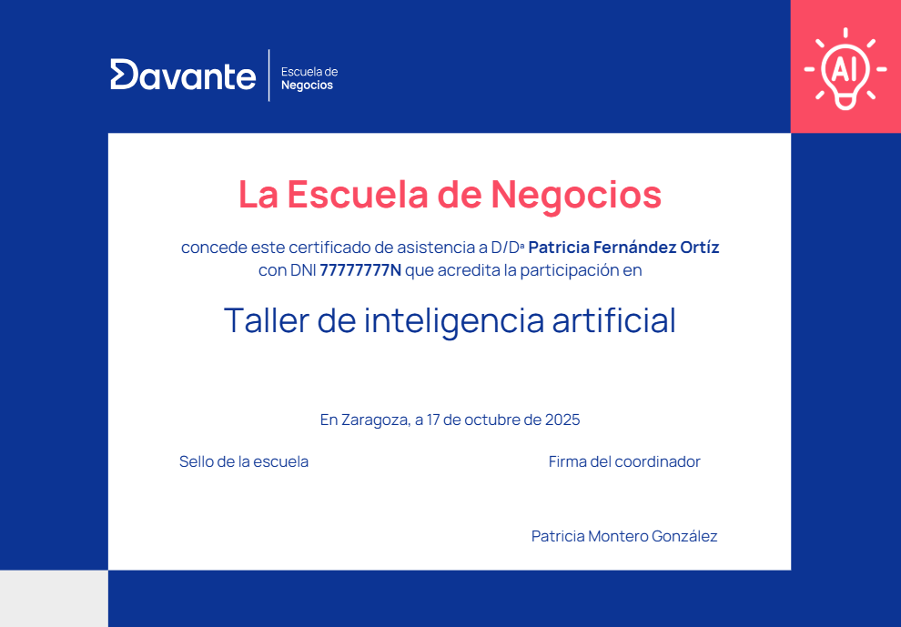

# Curso superior de wedding planner y organización de eventos

> **Ficha Técnica del Programa Formativo**
> **Nombre del curso:** Curso superior de wedding planner y organización de eventos
> **Código de curso:** 7212
> **Área:** Marketing, Ventas y Gestión Comercial
> **URL oficial:** [https://cambiamostuvida.es/cambiamostuvida/iniBienvenidaAlumno.htm?accion=INFORMACION_CURSO&curso=7212](https://cambiamostuvida.es/cambiamostuvida/iniBienvenidaAlumno.htm?accion=INFORMACION_CURSO&curso=7212)
> **Institución:** Davante | Escuela de Negocios y Marketing

---

## Índice de Contenidos

- [¿Quiénes somos?](#quienes-somos)
- [Presentación](#presentacion)
- [Pruebas Oficiales](#pruebas-oficiales)
- [Duración, horas y temario](#duracion-horas-y-temario)
- [Programa detallado](#programa-detallado)
- [Equipo y colaboradores](#equipo-y-colaboradores)
- [Metodología: lo que nos hace diferentes](#metodologia-lo-que-nos-hace-diferentes)
- [Clases y actividades docentes](#clases-y-actividades-docentes)
- [Prácticas en empresas](#practicas-en-empresas)
- [Casos de éxito](#casos-de-exito)
- [Aval/Diploma/Certificado](#avaldiplomacertificado)
- [Salidas profesionales](#salidas-profesionales)
- [Ventajas para alumnos](#ventajas-para-alumnos)
- [Trabajos de alumnos](#trabajos-de-alumnos)
- [Alumnado internacional](#alumnado-internacional)
- [Talento Davante](#talento-davante)

---

## ¿Quiénes somos?

> ** ¡Hola!**

Antes de nada, queremos presentarnos.

Somos **Davante.** Fruto de la unión entre**Master.D** y **MEDAC,**dos referentes históricos en el sector educativo de España, que han contribuido al desarrollo profesional de **más de 1.000.000 de personas**.**

> **Cifras:**

Estás aquí porque ya nos conoces (aunque sea un poco) y quieres saber más. Por eso, seguro que has oído eso de que **Davante da lo que nadie más te da.** Lo decimos porque estamos convencidos. **No es palabrería,** ni siquiera una frase pegadiza. Estamos seguros de lo que decimos y por eso estamos aquí:**para demostrarlo.**

| ¿Quieres formar parte de una de las escuelas con mejor empleabilidad de España?

 ¿Quieres entrar en uno de los programas premiados como mejor centro educativo para la transformación e innovación digital? |
| --- |

- **Premio de Excelencia Educativa** al mejor programa formativo para la**Inserción Profesional** y Premio de Excelencia Educativa al mejor programa formativo para la**Transformación e Innovación Digital.**

https://tv.masterd.es/contenidos-diseno-imagen-personal

Nuestro objetivo es**formar profesionales del sector** para que adquieran las competencias profesionales adecuadas para**incorporarse al mercado laboral,** bien por cuenta ajena o bien por cuenta propia.

.png)

> Síguenos en **nuestras redes sociales,** para estar al día de todo lo relacionado con tu futuro laboral y**Davante.Pincha en cada una de las imágenes para acceder a nuestras redes sociales**.**

> ** ¿Quieres comprobarlo? Continúa con nosotros.**

---

## Presentación

**"Curso recomendado por Zankyou",**portal líder en bodas con más de 350.000 novios/as registrados y 50 millones de visitas anuales en más de 23 países.

** ¿Te has fijado en que cada vez le damos más importancia a la organización de eventos? ¿Y que, cada vez, tenemos menos tiempo para poder dedicarnos a lo que nos gustaría?**

Gracias a los *wedding planners* ya es posible, a través de asesores especializados del sector,**organizar** una boda, comunión, bautizo, cumpleaños o evento social**de una forma profesional,** sin necesidad de hacerlo nosotros mismos. No se trata solo de elegir una iglesia o un restaurante. Hay muchos más componentes que tener en cuenta para**que todo salga bien** en un día tan importante.

Con nuestro curso de *wedding planner* aprenderás todos los aspectos necesarios para poder organizar con garantías todo tipo de**bodas, banquetes, bautizos, comuniones y eventos sociales.**

Fórmate en **una de las profesiones más demandadas y apasionantes. **Con nuestro curso aprenderás todos los secretos para organizar este tipo de eventos.

Con esta formación, podrás trabajar **por cuenta propia** montando tu empresa de organización de eventos o**por cuenta ajena** en empresas del sector.

** ¿Quieres dar un paso más?** Especialízate con nosotros.

El mercado cada vez demanda más perfiles enfocados a las nuevas tecnologías,***Davante te ofrece la posibilidad de especializarte***al mismo tiempo que cursas tus estudios, ** ¡elige la tuya!:**

- ***Inteligencia Artificial en marketing digital.***
- ***Eventos de moda.***
- ***Redes Sociales.***

> ¿A qué esperas? ***Elige tu especialidad y da un salto en tu carrera profesional**.***

Con nuestra especialidad tienes la posibilidad de optar a uno o varios **Certificados de Especialización Universitaria.**

**Consulta condiciones***

Ponemos a tu disposición multitud de herramientas y recursos para alcanzar tu objetivo. **Orientadores, Profesores, Talleres y Masterclass Presenciales, dinámicas de grupo, clases en directo, Video Clases 24 horas, Campus de última generación como verdadera comunidad de aprendizaje, certificaciones oficiales...**

Son muchos los aspectos a tener en cuenta en una organización de una boda, en la siguiente imagen reflejamos el **timing** de todos aquellos aspectos necesarios a tener en cuenta y en lo que hay que formarse.

.jpg)

El trabajo de una wedding planner, además de asesorar, decorar y organizar, es buscar proveedores que se ajusten tanto al estilo de la boda, como a los gustos y necesidades de los novios. A continuación, te ofrecemos una checklist con la que puedes trabajar en tu futuro profesional:

Además, podrás **certificarte oficialmente** en**Google Ads y Google Analytics,** y conseguir**certificaciones propias** de**Trello, Canva y Mailchimp, Redes Sociales, Filmora, Hootsuite, Metricool...**

.png)

Además, somos socios de **DIRCOM (Asociación de Directivos de Comunicación),** lo cual respalda nuestra formación y nos provee de ventajas en el sector.

.jpg)

Entre nuestros colaboradores contamos con **expertos del sector de la comunicación**, te presentamos algunos de ellos:

---

## Pruebas Oficiales

El perfil profesional de esta formación queda determinado por su competencia general, sus competencias profesionales, personales y sociales, por la relación de cualificaciones y, en su caso, **unidades de competencia del Catálogo Nacional de Cualificaciones Profesionales**incluidas en el título.

Cuando termines tu formación con nosotros, podrás acceder al proceso de acreditación de competencias para obtener la **cualificación profesional** correspondiente.

Este curso **está pensado para que puedas acceder a los procesos de acreditación de cualificaciones profesionales** de**nivel III**:

- **COM731_3 - Gestión de eventos corporativos¿Qué es una cualificación profesional?**

Una cualificación profesional es un documento **oficial**que **acredita** a un/a trabajador/a en una**cualificación profesional** del Catálogo Nacional de las Cualificaciones Profesionales.

Las Cualificaciones Profesionales se definen como un conjunto de competencias profesionales adquiridas a través de la experiencia laboral acreditada y a través de la formación ocupacional o reglada. Cada una de estas competencias está asociada a un módulo formativo. Una vez conseguida el conjunto de competencias de una Cualificación Profesional, un sujeto obtendrá el certificado profesional correspondiente a dicha cualificación.

Está recogido a**nivel europeo** en el MEC (Marco Europeo de Cualificaciones) para la educación superior, que facilita el acceso al mercado laboral en toda Europa e impulsar la movilidad transfronteriza.

.png)

** ¿Qué más utilidades tienen las cualificaciones profesionales?**

Efectos acumulables: te permiten seguir estudiando e incluso llegar a conseguir un **Título de Formación Profesional.**

Si cumples los requisitos acceso Grado Medio y Grado Superior, podrás convalidar módulos profesionales y superar los restantes hasta finalizarlo.

---

## Duración, horas y temario

> **Duración y horas.**

La duración total del curso superior completo es de **400 horas**. Dispondrás de un periodo máximo de**18 meses** a partir de la fecha de matriculación para completar el curso completo.

Si decides realizar la **<u>especialización</u>**:

- La duración total del curso superior completo con especialización es de**500 horas.**
- Dispondrás de un periodo máximo de **24 meses** a partir de la fecha de matriculación para completar el curso completo con especialización.

> **Este es el temario de tu curso.**

Las asignaturas de este programa son las siguientes:

- Wedding planner: la profesión
- Protocolo y organización en las bodas
- Códigos de vestir: protocolo y asesoría
- Estilos decorativos
- El trabajo de un wedding planner
- Marketing, comunicación y publicidad
- Planificación y gestión de eventos
- Aspectos legales de un wedding planner
- Trabajo final de curso

** ¿Quieres dar un paso más?** Especialízate con nosotros.

El mercado cada vez demanda más perfiles enfocados a las nuevas tecnologías,***Davante te ofrece la posibilidad de especializarte***al mismo tiempo que cursas tus estudios, ** ¡elige la tuya!:**

- ***Inteligencia Artificial en marketing digital.***
- ***Eventos de moda.***
- ***Redes Sociales.***

> ¿A qué esperas? ***Elige tu especialidad y da un salto en tu carrera profesional**.***

Con nuestra especialidad tienes la posibilidad de optar a uno o varios **Certificados de Especialización Universitaria.**

---

## Programa detallado

**1. Wedding planner: la profesión**

- Historia: cómo ha surgido la profesión
- Funciones y característica de un wedding planner

**2. Protocolo y organización en las bodas**

- Protocolo en la pedida de mano
- Protocolo en los preparativos
- Protocolo en las bodas católicas
- Protocolo en las bodas civiles
- Protocolo en las bodas militares
- Necesidades en la celebración y fiesta

**3. Códigos de vestir: protocolo y asesoría**

- La novia
- El novio
- El cortejo nupcial

**4. Estilos decorativos**

- Estilos clásico y romántico
- Estilos rústico y boho chic
- Estilos shabby chic y vintage
- Estilos ibicenco, tropical e industrial

**5. El trabajo de una wedding planner**

- Los clientes: reuniones, presupuestos, contratos y formas de pago
- Los proveedores de las bodas
- Organización de una boda: pasos, técnicas e imprevistos
- Más trabajos de una wedding planner

**6. Marketing, comunicación y publicidad**

- Investigación de mercados
- Identidad corporativa
- Página web: diseño y posicionamiento
- Las redes sociales de un wedding planner
- Estrategias de relaciones públicas
- Los medios de comunicación del sector

**7. Planificación y gestión de eventos**

- Tipos de eventos
- El evento como proyecto
- Organización de eventos
- Dirección y control de eventos
- Proveedores y servicios requeridos en la organización de eventos
- Protocolo en eventos

**8. Aspectos legales de un wedding planner**

- Regímenes de la seguridad social
- Contratación y tipos de contratos
- Formación y orientación laboral
- Documentos de cobro y pago
- Facturación y altas

**9. Proyecto final de curso**

---

## Equipo y colaboradores

En la **Escuela de Negocios Davante** ponemos a tu disposición un**equipo docente** con experiencia en el sector que te ayudarán a que consigas tu objetivo.

> > ** ¿Quieres conocerlos?**

🔗 **Recurso interactivo:** [Vídeo explicativo](https://www.escuelanegociosdavante.es/equipo)

Además, colaboramos con un **equipo de expertos en activo** que te transmitirán toda su experiencia y conocimiento a través de diferentes actividades.

---

## Metodología: lo que nos hace diferentes

**Desde el primer día,** el método Davante te ofrece una**preparación única:**

- **Innovadora, práctica, personalizada** y, lo más importante, centrada en tu**empleabilidad.**

---

## Clases y actividades docentes

> **Clases en directo y videoclases.**

Tendrás la posibilidad de acceder a **clases *on-line,*** a través del Campus Virtual, en las que te explicaremos materias de tu curso, te enseñaremos técnicas de estudio, consejos y todo lo que necesites.

Te ofrecemos varios tipos de clases:

- **<u>Clases en directo</u>:** en ellas puedes**interactuar con el profesor,**con tus compañeros,** preguntar**en directo** las dudas que te vayan surgiendo.Además, como **quedan grabadas,** puedes volver a verlas todas las veces que quieras.
- **<u>Videoclases 24 horas</u>:** son clases**grabadas** impartidas por expertos, por lo que puedes verlas sin tener que desplazarte, de una forma sencilla a través de tu**ordenador, *tablet* o móvil.**

https://tv.masterd.es/marketing-para-principiantes

> **Eventos, *masterclasses,* clases temáticas.**

Ya te hemos dicho que damos lo que nadie más te da. Nos referimos, entre otras cosas, a talleres, seminarios, eventos, programas en nuestra televisión educativa e incluso algún pódcast (sí, es cierto: **tenemos una televisión y una radio propias** ).

https://tv.masterd.es/eventos-marketing-ventas

Además, dentro de estos talleres podrás obtener**6 diplomas adicionales en herramientas de**INTELIGENCIA ARTIFICIAL**,** poniendo en práctica habilidades necesarias para mejorar tu empleabilidad:

- Mejora tu perfil profesional en LinkedIn con IA
- Crea tu contenido en redes sociales con IA
- Crea presentaciones de tus productos con IA
- Crea tu página web con IA
- Crea tu porfolio con IA
- Crea tu videocurrículum con IA

Todos los meses habrá un taller de Inteligencia artificial en tu centro.

> **Expertos colaboradores.**

Además, entre **nuestros expertos colaboradores** contamos con prestigiosos profesionales en activo.

Te dejamos un ejemplo de una de ellas con **Mery Hermida,** creadora de la comunidad**Y le dije sí,** donde recopila historias de peticiones de manos.

🎥 **Vídeo:** [Vídeo explicativo](https://www.youtube.com/watch?v=C0DA1oPbh6E)

> ** ¿Y si te has perdido el taller o no estás en la ciudad donde se imparte?**

No pasa nada, lo tenemos todo previsto y ensayado. Podrás visualizarlo **en directo a distancia** o verlo grabado**cuando y donde quieras.**

---

## Prácticas en empresas

Con este curso podrás optar a la **realización de tus prácticas** en empresas del sector que te ayudarán a consolidar los conocimientos que vas a aprender. Como grupo educativo colaboramos **más de 6.000 empresas,** entre las cuales se encuentran las**mejores empresas del sector.**

Algunas de las empresas de***wedding planner*** que colaboran con nosotros son.

Cuando finalices la parte teórica del curso, podrás realizar el **módulo de inserción laboral** y solicitar la gestión de**prácticas en empresas colaboradoras.**

---

## Casos de éxito

Aquí puedes ver como **Verónica**, alumna del Curso de Wedding Planner y Organización de Eventos, ha montado su propia empresa. ¡No te pierdas este video!

🎥 **Vídeo:** [YouTube video player](https://www.youtube.com/watch?v=-fcirKVXZVI)

**Alba**, también del Curso de Wedding Planner y Organización de Eventos, ha montado su propia empresa y es la responsable de protocolo y eventos de Catering la Serrana, ubicado en el sur de nuestro país. ¡No te pierdas su entrevista!

🎥 **Vídeo:** [YouTube video player](https://www.youtube.com/watch?v=U6_UnXhRWZg)

---

## Aval/Diploma/Certificado

Después de superar con éxito los contenidos de tu programa, recibirás el título propio de **Davante | Escuela de Negocios:**

> **Especialízate.**

Si decides especializarte, podrás optar a un certificado de **curso universitario de especialización,** acreditado por la**Universidad de Vitoria-Gasteiz:**

En los **talleres de Inteligencia artificial** recibirás un total de 6 diplomas por cada uno que realices**.**

> **Espera, aún hay más.**

Como te adelantábamos al principio, **damos lo que nadie más te da.** Por eso, podrás conseguir**un diploma por cada competencia** que completes en nuestro sistema**Fundamentos 360.**

> **Espera, todavía hay más.**

Además, podrás **certificarte oficialmente** en**Google Ads y Google Analytics,** y conseguir**certificaciones propias** de**Trello, Canva y Mailchimp, Redes Sociales, Filmora, Hootsuite, Metricool...**

.png)

---

## Salidas profesionales

Con este curso superior **podrás trabajar**en la organización total o parcial de bodas, ya sea dentro de una empresa de organización de eventos o creando y gestionando tu propia empresa de organización de bodas y eventos.

> **Salario**

- De 1.500 euros a 3.000 euros por evento.
- 50.000 euros sueldo medio anual
- Podrías facturar hasta 100.000 euros año.

> ** ¿Y para ello que ponemos en tu mano?**

Davante da lo que nade más te da: la oportunidad de **triunfar en el mundo laboral con TALENTO DAVANTE.**

---

## Ventajas para alumnos

Somos socios de **DIRCOM (Asociación de Directivos de Comunicación)**lo cual respalda nuestra formación y nos provee de disponer de ventajas en el sector

.jpg)

Además, podrás **certificarte oficialmente** en**Google Ads y Google Analytics,** y conseguir**certificaciones propias** de**Trello, Canva y Mailchimp, Redes Sociales, Filmora, Hootsuite, Metricool...**

.png)

** ¿Quieres dar un paso más?** Especialízate con nosotros.

El mercado cada vez demanda más perfiles enfocados a las nuevas tecnologías, ***Davante te ofrece la posibilidad de especializarte***al mismo tiempo que cursas tus estudios, ** ¡elige la tuya!**

Con nuestra especialidad tienes la posibilidad de optar a uno o varios **Certificados de Especialización Universitaria.**

** ¿Tienes un proyecto en la cabeza? ¿Quieres montar un negocio o empresa?** Como alumno de la escuela te ofrecemos de forma totalmente gratuita nuestro**Servicio de asesoramiento para emprendedores**. Te ayudamos a desarrollar tu idea y darle forma.

Además, si lo deseas podrás disponer de servicio de **Inglés**de forma voluntaria y manera gratuita con el curso (en alguno de estos niveles A2, B1, B2, C1).

---

## Trabajos de alumnos

Aquí tienes un ejemplo de uno de nuestros **retos creativos** llevado a cabo por**Lorena,** una de**nuestras alumnas** de Valencia.

###### Boda San Valentín

🎥 **Vídeo:** [Vídeo explicativo](https://www.youtube.com/watch?v=_0tEwoUwr64)

###### Preparación del *shooting* para una boda de San Valentín

🎥 **Vídeo:** [Vídeo explicativo](https://www.youtube.com/watch?v=-nrL5mK5tmI)

**Carmen Miriam**, alumna de la delegación de Málaga, participó en uno de los retos creativos, dando vida a este bonito centro de mesa.

Por su parte, **Alazne Corbella**, de Bilbao, realizó este centro de mesa para una boda de invierno:

**María Giménez** dio vida a esta invitación inspirada en Sevilla:

**Lorena Sepúlveda**, de Valencia, diseño con papel reciclado una invitación para una boda minimalista:

**Mónica González**, de Madrid, diseñó esta minuta, mesero y tarjeta de agradecimiento para una boda de estilo Shabby-Chic.

Paz Becerra, alumna de Málaga, creó este seating plan para una boda otoñal inspirada en la sierra de Madrid.

**Cristina Navas**, de Madrid, diseñó este centro eco-friendly para una boda de estilo boho chic.

.JPG)

**Alejandro Martín**, de Sevilla, creó este centro de mesa para una boda temática de Navidad.

---

## Alumnado internacional

> **Estudiar desde el extranjero.**

Para **Davante,** tienen la consideración de**alumnado internacional** todas las personas que soliciten cursar con nosotros una formación a distancia cuya**residencia esté fuera del territorio español, sea cual sea su nacionalidad.**

En **Davante** formamos a estudiantes de todos los lugares del mundo, ya que nuestra preparación está adaptada para que**cualquier persona, esté donde esté,** obtenga las habilidades suficientes para**entrar en el mercado laboral.Un dato:** más de 3.000 alumnos internacionales han confiado en nosotros para poder formarse y cumplir sus metas.

En España y Portugal somos **líderes en el sector de la formación abierta,** mientras que**en el resto del mundo** somos el**mayor centro de referencia** que tienen los hispanohablantes para poder formarse en su lengua. Como te decíamos, la calidad de nuestra formación está avalada y contrastada con**sellos de calidad** como EFQM.

> ***Cada vez somos más.***

Por un lado, hay una necesidad creciente de formación para profesionalizarse o conseguir un trabajo para toda la vida; por otro, en **Davante** somos**especialistas en formación a distancia.** A cualquier distancia.

**Otro dato:** en los últimos años, el porcentaje de alumnado internacional que ha crecido un 60%.

Hay miles de personas, de **más de 100 países,** que diariamente se conectan y siguen sus estudios con nosotros. **Suiza, Reino Unido, México, Alemania, Italia** o**Francia** son algunos de los países en los que nuestro alumnado recibe formación.

Hoy por hoy, **más de 2.500 alumnos**se encuentran en otros países.

> **No hay distancia que nos separe.**

Si decides continuar con nosotros, tendrás **acceso a todos los servicios** que ofrecemos.

Si quieres recibir una **formación de calidad, contrastada y avalada** por un centro de formación con más de 30 años de experiencia, estamos aquí para ayudarte. Hoy en día no existen fronteras para el saber ni para la formación. En**Davante** lo sabemos y por eso llevamos**desde 1994** manejando**tecnología de vanguardia,** siendo**líderes absolutos en formación abierta.**

Si quieres, estaremos cerca de ti, aunque nos separen miles de kilómetros. Podemos asegurarlo porque pondremos a tu disposición un campus virtual de última generación, una televisión educativa propia, contenido actualizado constantemente, tutorías *on-line,* servicio de orientación, talleres*on-line* de habilidades... Todo ello de forma**flexible y adaptada a tus necesidades.**

> **Todo esto y mucho más.**

Trabajamos diariamente para que no notes los miles de kilómetros que nos separan, pero también para poner a tu disposición nuevos servicios. Nos enorgullecemos de escuchar a nuestro alumnado y de darle lo que necesita para que alcance sus metas. Por eso, no solo ponemos toda nuestra tecnología a tu servicio, **te damos lo que nadie más te da.**

Tenemos **tanto que ofrecerte** que, para finalizar,**te dejamos <u>un resumen</u>:**

- Ponemos a tu alcance el material del curso, estés donde estés, siempre actualizado.
- Impartimos clases en directo a través de nuestro campus virtual (además, quedan grabadas, así que podrás verlas cuando y donde quieras).
- Contenidos impartidos por el equipo docente, tus profesores y profesoras, que son quienes mejor conocen lo que debes aprender.
- Habilidades u orientación académica y laboral: nuestro equipo de orientadores te ayudará a entrenar las habilidades necesarias para lograr tus objetivos. También pondrá a tu alcance todas las herramientas que necesites para triunfar en el mundo laboral.
- Emitimos para todo el mundo talleres, seminarios, charlas con expertos, *masterclass,* etcétera, a los que puedes conectarte en tiempo real (en horario de España), preguntar dudas, compartir inquietudes con otros alumnos y, por supuesto, todo queda grabado para que no te pierdas nada.
- Puedes cambiar tu condición de alumno/a internacional en cualquier momento (si llega el momento, pregúntanos y te informaremos).
- Nuestros diplomas se emiten en varios idiomas (inglés, francés, alemán, italiano, etcétera).
- Si necesitas un certificado de matriculación o finalización de tu formación, tan solo tienes que solicitarlo.
- Módulos complementarios de los idiomas inglés, español y francés.
- Además, si lo deseas, podrás solicitar que apostillemos tu diploma notarialmente mediante la Apostilla de La Haya. Gracias a ello podrás certificar la autenticidad de nuestro diploma.

> ** ¿Sabes qué es la Apostilla de la Haya?**

Puedes consultar toda la información haciendo clic en **[este enlace](https://www.hcch.net/es/instruments/specialised-sections/apostille/).**

Y aquí tienes un ejemplo:

> ** ¿Qué opinan de nosotros?**

Te invitamos a que eches un vistazo a lo que nuestro alumnado internacional opina de nosotros. Estamos muy orgullosos de lo que han conseguido.

🔗 **Recurso interactivo:** [Vídeo explicativo](https://www.opinionesmasterd.es/internacional)

---

## Talento Davante

Ya estamos terminando y queremos volver a lo que te decíamos al principio.

** ¿Recuerdas aquello de que te damos más que nadie? Pues nos reafirmamos**.**

Davante da lo que nade más te da: la oportunidad de **<u>triunfar en el mundo laboral</u>.**

Para acompañarte a construir tu trayectoria profesional, ponemos a tu disposición <u>tres herramientas fundamentales</u>:**Davante Empleo, Davante**Emprende** y**Davante x InfoJobs.**

Te lo contamos ahora mismo.

> **Davante empleo.**

Es un servicio exclusivo diseñado para apoyarte en tu inserción y desarrollo profesional, desde el que accederás a todo esto:

- **Ofertas de trabajo exclusivas para alumnado Davante,** tanto de la red Jobteaser, como propias. Más de 30.000 ofertas disponibles.
- Acceso al **listado de empresas** con las que tenemos acuerdos para ofrecerte ofertas de empleo (estas vacantes y las anteriores<u>**no aparecen en otros buscadores de empleo**</u> ).
- **Eventos profesionales** de todos los sectores y en todos los formatos, donde podrás conocer y hacer*networking* con empresas de tu sector. ¡No te los puedes perder!
- **Consejos de empleabilidad** muy útiles para acceder al mercado laboral.
- **Recursos Davante:** portales de empleo, orientación laboral, emprendimiento, salidas profesionales...

> **Davante Emprende.**

Si tienes una **idea de negocio** y quieres llevarla al siguiente nivel montando**tu propia empresa,** esta es tu oportunidad. A través de un programa en tres fases, recibirás**formación, mentoría, recursos clave** y**premios** para poner en marcha tu negocio.

https://www.youtube.com/watch?v=q1osFN1qgRg

> **Davante x InfoJobs.**

¿Conoces InfoJobs? Si has buscado o estás buscando trabajo, seguro que sí. Es el portal de empleo de referencia nacional. En Davante, solamente **nos asociamos con los mejores.** Por eso, InfoJobs ha creado esta web donde se aglutinan**todas las ofertas publicadas en la plataforma,** organizadas por los sectores afines a tus estudios para que tus búsquedas sean más fáciles.

Lo mejor es que la veas y le eches un vistazo.

🔗 **Recurso interactivo:** [Vídeo explicativo](https://davante.infojobs.net/)
