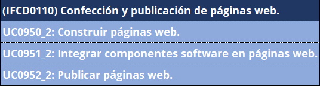
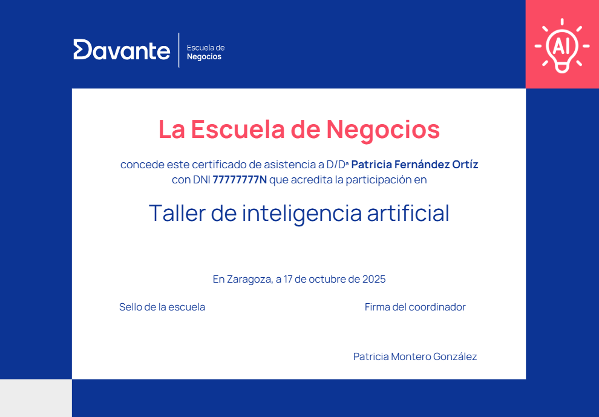
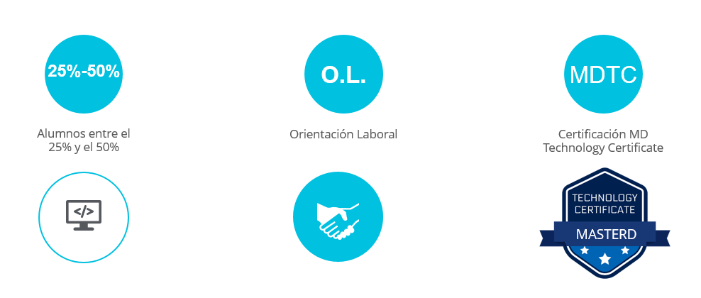
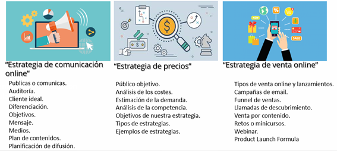

# Máster en desarrollo web y marketing digital

> **Ficha Técnica del Programa Formativo**
> **Nombre del curso:** Máster en desarrollo web y marketing digital
> **Código de curso:** 17371
> **Área:** Marketing, Ventas y Gestión Comercial
> **URL oficial:** [https://cambiamostuvida.es/cambiamostuvida/iniBienvenidaAlumno.htm?accion=INFORMACION_CURSO&curso=17371](https://cambiamostuvida.es/cambiamostuvida/iniBienvenidaAlumno.htm?accion=INFORMACION_CURSO&curso=17371)
> **Institución:** Davante | Escuela de Negocios y Marketing

---

## Índice de Contenidos

- [¿Quiénes somos?](#quienes-somos)
- [Presentación](#presentacion)
- [Pruebas Oficiales](#pruebas-oficiales)
- [Duración, horas y temario](#duracion-horas-y-temario)
- [Programa detallado](#programa-detallado)
- [Equipo y colaboradores](#equipo-y-colaboradores)
- [Metodología: lo que nos hace diferentes](#metodologia-lo-que-nos-hace-diferentes)
- [Clases y actividades docentes](#clases-y-actividades-docentes)
- [Prácticas docentes](#practicas-docentes)
- [Prácticas en empresas](#practicas-en-empresas)
- [Casos de éxito](#casos-de-exito)
- [Aval/Diploma/Certificado](#avaldiplomacertificado)
- [Salidas profesionales](#salidas-profesionales)
- [Ventajas para alumnos](#ventajas-para-alumnos)
- [Alumnado internacional](#alumnado-internacional)
- [Talento Davante](#talento-davante)

---

## ¿Quiénes somos?

> ** ¡Hola!**

Antes de nada, queremos presentarnos.

Somos **Davante.** Fruto de la unión entre**Master.D** y **MEDAC,**dos referentes históricos en el sector educativo de España, que han contribuido al desarrollo profesional de **más de 1.000.000 de personas**.**

> **Cifras:**

Estás aquí porque ya nos conoces (aunque sea un poco) y quieres saber más. Por eso, seguro que has oído eso de que **Davante da lo que nadie más te da.** Lo decimos porque estamos convencidos. **No es palabrería,** ni siquiera una frase pegadiza. Estamos seguros de lo que decimos y por eso estamos aquí:**para demostrarlo.**

| ¿Quieres formar parte de una de las escuelas con mejor empleabilidad de España?

 ¿Quieres entrar en uno de los programas premiados como mejor centro educativo para la transformación e innovación digital? |
| --- |

- **Premio de Excelencia Educativa** al mejor programa formativo para la**Inserción Profesional** y Premio de Excelencia Educativa al mejor programa formativo para la**Transformación e Innovación Digital.**

https://tv.masterd.es/contenidos-diseno-imagen-personal

Nuestro objetivo es**formar profesionales del sector** para que adquieran las competencias profesionales adecuadas para**incorporarse al mercado laboral,** bien por cuenta ajena o bien por cuenta propia.

.png)

> Síguenos en **nuestras redes sociales,** para estar al día de todo lo relacionado con tu futuro laboral y**Davante.Pincha en cada una de las imágenes para acceder a nuestras redes sociales**.**

> ** ¿Quieres comprobarlo? Continúa con nosotros.**

---

## Presentación

¿Sabes cuantos segundos tienes para atraer la atención de un usuario en una página web? **Una media de 3 segundos.**

Como ves, es un tiempo muy limitado en el que has de demostrar tus dotes como programador o programadora Web. Mediante nuestro **máster en Desarrollo Web y Marketing Digital**,no solo te vamos a enseñar a desarrollar tu sitio web sino, que también aprenderás a sacar partido a todos los recursos del Marketing Digital para atraer a tus clientes.

**Desarrollo web y *marketing* digital son dos áreas que van de la mano en este nuevo ecosistema digital**.Un desarrollador Web va a ser capaz de crear un sitio web utilizando lenguajes como HTML, CSS, JavaScript, Python o PHP; además de utilizar las herramientas **FullStack** que harán más fácil el desarrollo (BootStrap, Materialize, WordPress, etcétera).

Estos conocimientos, sumados a la experiencia en **posicionamiento, análisis y marketing en general**, harán de tus desarrollos web un arma fundamental para obtener el beneficio deseado.

Súmate a este **perfil profesional 360º** que las empresas necesitan. Obtén, además, numerosas certificaciones de marca que harán que tu currículum destaque sobre el de la mayoría:**Certificado de Microsoft MTA en HTML5, Certificado en Google Ads y Analytics y certificados en herramientas digitales.**

> ** ¿Qué aprenderás en esta formación?**

Los **objetivos** planteados con esta formación, son:

- Aprender los básicos de la programación **HTML** y el diseño de hojas de estilo**CSS** hasta la creación de sitios web estáticos, basándonos en diseños predefinidos y plantillas creadas por nosotros mismos.
- Usar potentes y flexibles herramientas de edición de código con el fin de poder realizar trabajos profesionales.
- Aprender a crear sitios web.
- Comprender el uso de variables, operadores, objetos del lenguaje y navegador.
- Aprender a crear efectos web usando **JavaScript**.
- Comprender la metodología y el funcionamiento del modelo entidad-relación en una base de datos **MySQL**.
- Aprender los fundamentos del lenguaje SQL y el manejo de sentencias para realizar búsquedas y multitud de consultas.
- Interactuar con la base de datos a través del lenguaje de programación **PHP** para mostrar dinámicamente valores almacenados previamente, incluir nuevos datos y modificarlos vía web.
- Aprender a instalar, administrar y configurar el servicio web **Apache** en un equipo destinado a ofrecer y servir contenido web en una red local o en Internet.
- Aprender las técnicas de comercio electrónico y las leyes establecidas.
- Implantar los diferentes métodos de pago existentes para realizar transacciones electrónicas seguras.
- Conocer la legislación vigente en el marco actual del comercio electrónico y sus consecuencias.
- Estudiar y llevar a la práctica los procedimientos de actuación para implantar las normativas referentes a seguridad y las leyes de protección de datos en el ámbito empresarial y corporativo.
- Conocer las últimas **tendencias de marketing en la red.**
- Mejorar el **posicionamiento web** a través del conocimiento**SEO.**
- Gestionar campañas**SEM Y PPC.**
- Diseño del **contenido web (Branded Content).**
- Diseño de**Landing Pages.**
- Realizar **estudios de mercado.**
- **Analítica web** y definición de los principales**KPI.**
- Mejorar la conversión a través del**Inbound Marketing.**
- Conocimiento del **Big Data.**
- Crear campañas de **Marketing en Redes Sociales (Social Ads).**
- Manejo de **Herramientas Digitales (**Google Analytics, Google Ads).**
- Crear campañas digitales en**Mobile Marketing.**
- Mejora del reconocimiento de **marca y reputación.**
- **Captación de**clientes** potenciales.
- **Fidelización** de clientes actuales.

> ** ¡Obtén una doble titulación!**

Titulación por**Davante | Escuela de Negocios**+ Titulación por **MDigital | Escuela de Talento Digital de Davante.**

Ponemos a tu disposición multitud de herramientas y recursos para alcanzar tu objetivo. **Orientadores, Profesores, Talleres y Masterclass, dinámicas de grupo, clases en directo, Video Clases 24 horas, Campus de última generación como verdadera comunidad de aprendizaje, certificaciones oficiales.¿Quieres dar un paso más?** Especialízate con nosotros

El mercado cada vez demanda más perfiles enfocados a las nuevas tecnologías,***Davante te ofrece la posibilidad de especializarte***al mismo tiempo que cursas tus estudios, ** ¡elige la tuya!:**

- ***Inteligencia Artificial en marketing digital.***
- ***E-commerce.***
- ***Redes Sociales.***

> ¿A qué esperas? ***Elige tu especialidad y da un salto en tu carrera profesional**.***

Con nuestra especialidad tienes la posibilidad de optar a uno o varios **Certificados de Especialización Universitaria.**

**Consulta condiciones***

Además, podrás **certificarte oficialmente** en**Google Ads y Google Analytics,** y conseguir**certificaciones propias** de**Trello, Canva y Mailchimp, Redes Sociales, Filmora, Hootsuite, Metricool*,**Html, CSS, JavaScript...**

Además, somos socios de **MKT (Asociación de Marketing de España)** lo cual respalda nuestra formación y nos provee de disponer de ventajas en el sector

(1).png)

Y formamos parte del programa de marketing **"Google Partners"**

---

## Pruebas Oficiales

**CERTIFICADOS DE PROFESIONALIDAD**

Un certificado de profesionalidad es un documento que **acredita** a un/a trabajador/a en una**cualificación profesional** del Catálogo Nacional de las Cualificaciones Profesionales.

> Prepárate con nuestros **docentes especialistas** que forman parte de los equipos de asesoramiento y evaluación de los Procesos de Evaluación y Acreditación de Competencias.

Son emitidos por el **Servicio público de Empleo Estatal (S.E.P.E)**

Poseer un **certificado de profesionalidad** supone sin lugar a dudas incrementar sustancialmente tu**currículum profesional**, ya que, al ser un documento oficial, se valora en cualquier proceso de selección que convoque las administraciones públicas, y te acredita profesionalmente ante la **empresa privada**

Este certificado de profesionalidad que se llama **IFCD0110 Confección y publicación de páginas web**.

Tendrás la convocatoria **a tu disposición dentro de tu campus virtual, al día siguiente de su publicación**. De esta manera tendrás más tiempo para organizarte y realizar la inscripción.

** ¿Te gustaría ver tu nombre en un diploma oficial?**

Cuando termines tu formación con nosotros, podrás acceder al proceso de acreditación para obtener el **certificado de profesionalidad "**IFCT0110 Confección y publicación de páginas web**.**"CUALIFICACIONES PROFESIONALES**

Cuando termines tu formación con nosotros, podrás acceder al proceso de acreditación de competencias para obtener la **cualificación profesional**correspondiente.

Este curso **está pensado para que puedas acceder a los procesos de acreditación de cualificaciones profesionales** de**nivel III**:

- **COM708_3 - Gestión de la estrategia de marketing digital**
- **COM709_3 - Gestión del comercio electrónico¿Qué es una cualificación profesional?**

Una cualificación profesional es un documento **oficial**que **acredita** a un/a trabajador/a en una**cualificación profesional** del Catálogo Nacional de las Cualificaciones Profesionales.

Las Cualificaciones Profesionales se definen como un conjunto de competencias profesionales adquiridas a través de la experiencia laboral acreditada y a través de la formación ocupacional o reglada. Cada una de estas competencias está asociada a un módulo formativo. Una vez conseguida el conjunto de competencias de una Cualificación Profesional, un sujeto obtendrá el certificado profesional correspondiente a dicha cualificación.

Está recogido a**nivel europeo**en el MEC (Marco Europeo de Cualificaciones) para la educación superior, que facilita el acceso al mercado laboral en toda Europa e impulsar la movilidad transfronteriza.

.png)

** ¿Qué más utilidades tienen las cualificaciones profesionales?**

Efectos acumulables: te permiten seguir estudiando e incluso llegar a conseguir un **Título de Formación Profesional**.

Si cumples los requisitos acceso Grado Medio y Grado Superior, podrás convalidar módulos profesionales y superar los restantes hasta finalizarlo.

---

## Duración, horas y temario

> **Duración y horas**

La duración del curso es de**1.500 horas** y dispondrás de un periodo máximo de**24 meses** a partir de la fecha de matriculación para completar este programa formativo.

Además, podrás enriquecer tu formación con hasta 300 horas de prácticas voluntarias en empresas del sector; una excelente oportunidad para tomar la iniciativa y comenzar a abrirte camino en el entorno laboral.

Si te decides por cursar una **especialidad,** la duración total será de**1.600 horas** en un tiempo máximo de**25 meses.**

> **Temario de tu máster**

Las asignaturas de este programa son las siguientes:

- Plan de marketing e investigación de mercados
- Marketing digital
- SEO: Search Engine Optimization
- Marketing móvil
- Herramientas de publicidad digital
- Social Selling
- Publicidad programática
- Introducción a la programación
- Lenguajes de programación para Fullstack
- FullStack- Front End
- FullStack - Back End
- Trabajo final de máster

** ¿Quieres dar un paso más?** Especialízate con nosotros

El mercado cada vez demanda más perfiles enfocados a las nuevas tecnologías, ***Davante te ofrece la posibilidad de especializarte***al mismo tiempo que cursas tus estudios, ** ¡elige la tuya!:**

- ***Inteligencia Artificial en marketing digital.***
- ***E-commerce.***
- ***Redes Sociales.***

> ¿A qué esperas? ***Elige una especialidad y da un salto en tu carrera profesional**.**

Con nuestra especialidad tienes la posibilidad de optar a uno o varios **Certificados de Especialización Universitaria.**

---

## Programa detallado

**1. Plan de marketing e investigación de mercados**

- Introducción al marketing
- Branding
- Marketing mix
- Plan de marketing: investigación de mercados
- Plan de marketing: Objetivos y estrategias

**2. Marketing digital**

- Introducción al marketing digital
- Estrategias de marketing digital I
- Estrategias de marketing digital II
- La fuerza del cliente y el valor del dato
- Plan de marketing digital

**3. SEO: Search Engine Optimization**

- Posicionamiento SEO
- Keywords y SEO off page
- Auditoria SEO
- Plan estratégico SEO
- Herramientas de Google para SEO
- Informes y presupuesto

**4. Apps y ecosistemas digitales**

- Aplicaciones móviles
- Ecosistema de una App
- Publicidad en Apps
- Integración con otras plataformas

**5. Herramientas de publicidad digital**

- Estrategias de publicidad digital (SEM)
- Herramientas SEM
- Estrategia publicitaria en redes sociales
- Herramientas publicitarias en redes sociales
- Email marketing

**6. Social Selling**

- Introducción al Social Selling
- La web 2.0 y la comunicación digital
- Herramientas de gestión social media
- La reputación online
- Medición y tendencias
- El blog: importancia, creación y contenido

**7. Publicidad programática**

- Publicidad Programática
- Optimización y estrategias

**8. Introducción a la programación**

- Preparación a la unidad
- Programación: Introducción
- Programación: Fundamentos de la programación
- Programación: Algoritmos

**9. Lenguajes de programación para Fullstack**

- Introducción a Full Stack Development
- Elementos HTML
- Estructura y contenidos
- Formularios
- Testeo y validación del código HTML
- Definición de estilos CSS
- Clases e identificadores
- Estilos de textos
- Colores, fondos y bordes
- Estilos especiales
- Maquetación HTML5 - CSS3
- Introducción a JavaScript
- JS Variables
- JS Operadores y estructuras de control
- JS Funciones
- JS y los formularios
- Php, herramientas necesarias
- Php Variables y operadores
- Php Estructuras De Control Y Manejo De Excepciones
- Php funciones
- Bases de datos
- Php y Mysql

**10. FullStack- Front End**

- GIT
- Bootstrap
- AngularJS
- React
- Vue JS
- Material UI

**11. FullStack - Back End**

- WordPress
- Joomla
- Node.js
- Mongo DB
- Spring Framework con Java
- Python

**12. Trabajo final de máster**

---

## Equipo y colaboradores

En **Davante | Escuela de Negocios**y la**Escuela de Informática y Comunicaciones** ponemos a tu disposición un**equipo docente** con experiencia en el sector que te ayudarán a que consigas tu objetivo.

> ** ¿Quieres conocerlos?**

Además, colaboramos con un **equipo de expertos en activo** que te transmitirán toda su experiencia y conocimiento a través de diferentes actividades.

---

## Metodología: lo que nos hace diferentes

**Desde el primer día,** el método Davante te ofrece una**preparación única:**

- **Innovadora, práctica, personalizada** y, lo más importante, centrada en tu**empleabilidad.**

---

## Clases y actividades docentes

> **Clases en directo y videoclases.**

Tendrás la posibilidad de acceder a **clases *on-line,*** a través del Campus Virtual, en las que te explicaremos materias de tu curso, te enseñaremos técnicas de estudio, consejos y todo lo que necesites.

Te ofrecemos varios tipos de clases:

- **<u>Clases en directo</u>:** en ellas puedes**interactuar con el profesor,**con tus compañeros,** preguntar**en directo** las dudas que te vayan surgiendo.Además, como **quedan grabadas,** puedes volver a verlas todas las veces que quieras.
- **<u>Videoclases 24 horas</u>:** son clases**grabadas** impartidas por expertos, por lo que puedes verlas sin tener que desplazarte, de una forma sencilla a través de tu**ordenador, *tablet* o móvil.**

https://tv.masterd.es/marketing-para-principiantes

> **Eventos, *masterclass,* clases temáticas.**

Ya te hemos dicho que damos lo que nadie más te da. Nos referimos, entre otras cosas, a talleres, seminarios, eventos, programas en nuestra televisión educativa e incluso algún pódcast (sí, es cierto: **tenemos una televisión y una radio propias** ).

https://tv.masterd.es/eventos-marketing-ventas

Además, dentro de estos talleres podrás obtener**6 diplomas adicionales en herramientas de**INTELIGENCIA ARTIFICIAL**,** poniendo en práctica habilidades necesarias para mejorar tu empleabilidad:

- Mejora tu perfil profesional en LinkedIn con IA
- Crea tu contenido en redes sociales con IA
- Crea presentaciones de tus productos con IA
- Crea tu página web con IA
- Crea tu porfolio con IA
- Crea tu videocurrículum con IA

Todos los meses habrá un taller de Inteligencia artificial en tu centro.

> **Expertos colaboradores.**

Además, entre **nuestros expertos colaboradores** contamos con prestigiosos profesionales en activo.

> ** ¿Y si te has perdido el taller o no estás en la ciudad donde se imparte?**

No pasa nada, lo tenemos todo previsto y ensayado. Podrás visualizarlo **en directo a distancia** o verlo grabado**cuando y donde quieras.**

---

## Prácticas docentes

Sabemos lo importante que es poner en práctica tus conocimientos. Por eso, te ofrecemos lo que nadie más te ofrece: **más de 30 centros** repartidos por toda España para que realices las prácticas de tu curso en nuestras**aulas técnicas.**

De este modo, podrás realizar las siguientes prácticas en el aula técnica:

- **Programación HTML/CSS:**

- Práctica 1: Instalación de Servidor XAMPP.
- Práctica 2: Hola Mundo.
- Práctica 3: Uso de CSS.
- Práctica 4: Creación de sitio web.
- **Prácticas de JavaScript/Ajax:**

- Práctica 1: Uso de alerts.
- Práctica 2: Validación de formularios.
- Práctica 3: Uso de jQuery en páginas web (galerías y efectos).
- Práctica 4: Carga de datos dinámica.
- **Práctica de PHP:**

- Práctica 1: Hola mundo.
- Práctica 2: Conexión a base de datos.
- Práctica 3: Alta y modificación de datos.
- Práctica 4: Mostrar datos por navegador.

---

## Prácticas en empresas

Como grupo educativo, colaboramos más de **6.000 empresas**, entre las cuales se encuentran las mejores empresas de cada sector. Con este curso podrás optar a la realización de tus **prácticas en empresas** que te ayudarán a consolidar los conocimientos que vas a adquirir.

Aquí puedes ver algunas de las empresas que colaboran con nosotros.

Cuando finalices la parte teórica del curso, podrás realizar el **módulo de inserción laboral** y solicitar la gestión de**prácticas en empresas colaboradoras.**

---

## Casos de éxito

Lo que vas a ver a continuación es la prueba de que **los sueños se cumplen.** Pero ten en cuenta que tendrás que poner**toda tu pasión y todo tu esfuerzo.** Lo mejor es que te lo cuenten**personas que, como tú, confiaron en nosotros.**

No te pierdas **opiniones, consejos e historias** de su camino hasta el éxito. Si quieres ver testimonios reales de alumnado de**todas nuestras áreas formativas,** anímate y**dale al *Play.**🔗 **Recurso interactivo:** [Vídeo explicativo](https://tv.masterd.es/opiniones-marketing-ventas)***

---

## Aval/Diploma/Certificado

Después de superar con éxito los contenidos de tu programa, recibirás el título propio de **Davante | Escuela de Negocios:**

También recibirás un **diploma certificado**por**MDigital, la Escuela de Talento Digital de Davante.**

.jpg)

> **Especialízate.**

Si decides especializarte, podrás optar a un certificado de **curso universitario de especialización,** acreditado por la**Universidad de Vitoria-Gasteiz:**

En los **talleres de Inteligencia artificial** recibirás un total de 6 diplomas por cada uno que realices**.**

> **Espera, aún hay más.**

Como te adelantábamos al principio, **damos lo que nadie más te da.** Por eso, podrás conseguir**un diploma por cada competencia** que completes en nuestro sistema**Fundamentos 360.**

> **Espera, todavía hay más.**

Podrás **certificarte oficialmente** en**Google Ads y Google Analytics,** y conseguir**certificaciones propias** de**Trello, Canva y Mailchimp, Redes Sociales, Filmora, Hootsuite, Metricool...**

.png)

Recuerda que este curso también te prepara para la obtención del **certificado de la Escuela de Talento Digital MDTC en Programación HTML5: HTML, CSS, JavaScript.**

---

## Salidas profesionales

> **Ocupaciones o puestos de trabajo relacionados**

Al finalizar tu formación **podrás trabajar** como:

- Programador de páginas Web
- Diseñador Front-end
- Maquetador Web
- Programador Front-End y Back-end
- Director de marketing
- Responsable de marketing
- Consultor SEO-SEM (posicionamiento en buscadores web).
- Analista web.
- Emprendedor, Dirección de marketing y comercio electrónico.
- Gestor web
- Project Manager

> **Salario**

- Programador de páginas web: 26.000? 47.000 euros.
- Diseñador Front-end / Front-End Developer: 25.000? 60.000 euros.
- Maquetador Web: 20.000 - 30.000
- Programador Front-End y Back-End (Full Stack): 30.000? 90.000 euros.
- Director de marketing: 50.000? 85.000 euros.
- Responsable de marketing / Marketing Manager: 35.000? 70.000 euros.
- Consultor SEO-SEM: 25.000? 43.000 euros.
- Analista web / Analista digital: 24.000? 45.000 euros.
- Emprendedor / Dirección de marketing y comercio electrónico: 35.000 a 80.000 euros.
- Gestor web: 22.000? 40.000 euros.
- Project Manager: 30.000? 60.000 euros.

> ** ¿Y para ello que ponemos en tu mano?**

Davante da lo que nade más te da: la oportunidad de **triunfar en el mundo laboral con TALENTO DAVANTE.**

---

## Ventajas para alumnos

Con este máster podrás**certificarte oficialmente** en**Google Ads y Google Analytics,** y conseguir**certificaciones propias** de**Trello, Canva y Mailchimp, Redes Sociales, Filmora, Hootsuite, Metricool...**

.png)

Además, somos socios de **MKT (Asociación de Marketing de España)** lo cual respalda nuestra formación y nos provee de disponer de ventajas en el sector

** ¿Quieres dar un paso más?** Especialízate con nosotros.

El mercado cada vez demanda más perfiles enfocados a las nuevas tecnologías, ***Davante te ofrece la posibilidad de especializarte***al mismo tiempo que cursas tus estudios, ** ¡elige la tuya!**

Con nuestra especialidad tienes la posibilidad de optar a uno o varios **Certificados de Especialización Universitaria.**

** ¿Tienes un proyecto en la cabeza? ¿Quieres montar un negocio o empresa?** Como alumno de la escuela te ofrecemos de forma totalmente gratuita nuestro**Servicio de asesoramiento para emprendedores**. Te ayudamos a desarrollar tu idea y darle forma.

Además, si lo deseas podrás disponer de servicio de **Inglés**de forma voluntaria y manera gratuita con el curso (en alguno de estos niveles A2, B1, B2, C1).

Posibilidad de bonificar por **FUNDAE** para trabajadores en activo.

(consulta a tu asesor)

Aprovecha la oportunidad de formar parte de nuestro **"PROYECTO LANZADERA"** el cual permite una incorporación temprana de nuestros alumnos al mercado laboral.

Nuestro programa formativo tiene una duración completa determinada a la que sumamos un plan específico para los 4 primeros meses de tu formación en un perfil laboral concreto.

A ello sumamos numerosos acuerdos con empresas colaboradoras como el que te mostramos a continuación:

🎥 **Vídeo:** [YouTube video player](https://www.youtube.com/watch?v=k0jNtF4O9HI)

Necesitamos alumnos excelentes que se incorporen a un mercado laboral con mucha falta de profesionales cualificados ** ¿Quieres ser uno de estos alumnos?** Forma parte de nuestro**proyecto lanzadera** y ayúdanos a cerrar la brecha laboral en el sector INFORMÁTICA Y COMUNICACIONES existentes.

** ¿Cómo lo vas a conseguir?**

En los 4 primeros meses de curso te vas a formar en un perfil altamente demandado **(front-end)** y, siguiendo nuestra metodología de conocimientos + habilidades, te vas a certificar en nuestro**certificado MTDC en programación HTML5: HTML, CSS y JavaScrip.**

Todo esto, te va a dotar de competencias para acceder a nuestra **LANZADERA** de**incorporación temprana al mundo laboral**. Por supuesto, necesitamos de tu implicación y profesionalidad para ello.

Además, aprovecha la oportunidad de *conseguir clientes* utilizando los medios digitales mediante nuestro**Módulo de "Venta en Entorno Digital" de la mano de***Sara**Pellicer*, periodista y experta en comunicación para empresas**.*"La venta "online" crece un 55 % desde el inicio del confinamiento."**"La facturación del comercio online en España crece un 260% en 5 años."***

- **Unidad 1** - Estrategia de comunicación online

En esta unidad te vamos a enseñar a establecer una estrategia de comunicación online para que puedas sacar partido económico a tus aplicaciones.

- **Unidad 2** - Estrategia de precios

Es muy importante conocer la manera de monetizar tus aplicaciones, ya que, dependiendo del público al que estén enfocadas, tendrán un valor u otro y, de ello, depende tu éxito.

- **Unidad 3** - Estrategia de venta online

Debido a la Transformación Digital, empresas como INDITEX están viendo mermadas sus capacidades de venta en tiendas físicas.

Por ello, es de suma importancia que todo el mundo se suba al carro de la digitalización y sepa como vender sus productos en el mundo online utilizando todas las redes sociales posibles.

---

## Alumnado internacional

> **Estudiar desde el extranjero.**

Para **Davante,** tienen la consideración de**alumnado internacional** todas las personas que soliciten cursar con nosotros una formación a distancia cuya**residencia esté fuera del territorio español, sea cual sea su nacionalidad.**

En **Davante** formamos a estudiantes de todos los lugares del mundo, ya que nuestra preparación está adaptada para que**cualquier persona, esté donde esté,** obtenga las habilidades suficientes para**entrar en el mercado laboral.Un dato:** más de 3.000 alumnos internacionales han confiado en nosotros para poder formarse y cumplir sus metas.

En España y Portugal somos **líderes en el sector de la formación abierta,** mientras que**en el resto del mundo** somos el**mayor centro de referencia** que tienen los hispanohablantes para poder formarse en su lengua. Como te decíamos, la calidad de nuestra formación está avalada y contrastada con**sellos de calidad** como EFQM.

> ***Cada vez somos más.***

Por un lado, hay una necesidad creciente de formación para profesionalizarse o conseguir un trabajo para toda la vida; por otro, en **Davante** somos**especialistas en formación a distancia.** A cualquier distancia.

**Otro dato:** en los últimos años, el porcentaje de alumnado internacional que ha crecido un 60%.

Hay miles de personas, de **más de 100 países,** que diariamente se conectan y siguen sus estudios con nosotros. **Suiza, Reino Unido, México, Alemania, Italia** o**Francia** son algunos de los países en los que nuestro alumnado recibe formación.

Hoy por hoy, **más de 2.500 alumnos**se encuentran en otros países.

> **No hay distancia que nos separe.**

Si decides continuar con nosotros, tendrás **acceso a todos los servicios** que ofrecemos.

Si quieres recibir una **formación de calidad, contrastada y avalada** por un centro de formación con más de 30 años de experiencia, estamos aquí para ayudarte. Hoy en día no existen fronteras para el saber ni para la formación. En**Davante** lo sabemos y por eso llevamos**desde 1994** manejando**tecnología de vanguardia,** siendo**líderes absolutos en formación abierta.**

Si quieres, estaremos cerca de ti, aunque nos separen miles de kilómetros. Podemos asegurarlo porque pondremos a tu disposición un campus virtual de última generación, una televisión educativa propia, contenido actualizado constantemente, tutorías *on-line,* servicio de orientación, talleres*on-line* de habilidades... Todo ello de forma**flexible y adaptada a tus necesidades.**

> **Todo esto y mucho más.**

Trabajamos diariamente para que no notes los miles de kilómetros que nos separan, pero también para poner a tu disposición nuevos servicios. Nos enorgullecemos de escuchar a nuestro alumnado y de darle lo que necesita para que alcance sus metas. Por eso, no solo ponemos toda nuestra tecnología a tu servicio, **te damos lo que nadie más te da.**

Tenemos **tanto que ofrecerte** que, para finalizar,**te dejamos <u>un resumen</u>:**

- Ponemos a tu alcance el material del curso, estés donde estés, siempre actualizado.
- Impartimos clases en directo a través de nuestro campus virtual (además, quedan grabadas, así que podrás verlas cuando y donde quieras).
- Contenidos impartidos por el equipo docente, tus profesores y profesoras, que son quienes mejor conocen lo que debes aprender.
- Habilidades u orientación académica y laboral: nuestro equipo de orientadores te ayudará a entrenar las habilidades necesarias para lograr tus objetivos. También pondrá a tu alcance todas las herramientas que necesites para triunfar en el mundo laboral.
- Emitimos para todo el mundo talleres, seminarios, charlas con expertos, *masterclass,* etcétera, a los que puedes conectarte en tiempo real (en horario de España), preguntar dudas, compartir inquietudes con otros alumnos y, por supuesto, todo queda grabado para que no te pierdas nada.
- Puedes cambiar tu condición de alumno/a internacional en cualquier momento (si llega el momento, pregúntanos y te informaremos).
- Nuestros diplomas se emiten en varios idiomas (inglés, francés, alemán, italiano, etcétera).
- Si necesitas un certificado de matriculación o finalización de tu formación, tan solo tienes que solicitarlo.
- Módulos complementarios de los idiomas inglés, español y francés.
- Además, si lo deseas, podrás solicitar que apostillemos tu diploma notarialmente mediante la Apostilla de La Haya. Gracias a ello podrás certificar la autenticidad de nuestro diploma.

> ** ¿Sabes qué es la Apostilla de la Haya?**

Puedes consultar toda la información haciendo clic en **[este enlace](https://www.hcch.net/es/instruments/specialised-sections/apostille/).**

Y aquí tienes un ejemplo:

> ** ¿Qué opinan de nosotros?**

Te invitamos a que eches un vistazo a lo que nuestro alumnado internacional opina de nosotros. Estamos muy orgullosos de lo que han conseguido.

🔗 **Recurso interactivo:** [Vídeo explicativo](https://www.opinionesmasterd.es/internacional)

---

## Talento Davante

Ya estamos terminando y queremos volver a lo que te decíamos al principio.

** ¿Recuerdas aquello de que te damos más que nadie? Pues nos reafirmamos**.**

Davante da lo que nade más te da: la oportunidad de **<u>triunfar en el mundo laboral</u>.**

Para acompañarte a construir tu trayectoria profesional, ponemos a tu disposición <u>tres herramientas fundamentales</u>:**Davante Empleo, Davante**Emprende** y**Davante x InfoJobs.**

Te lo contamos ahora mismo.

> **Davante empleo.**

Es un servicio exclusivo diseñado para apoyarte en tu inserción y desarrollo profesional, desde el que accederás a todo esto:

- **Ofertas de trabajo exclusivas para alumnado Davante,** tanto de la red Jobteaser, como propias. Más de 30.000 ofertas disponibles.
- Acceso al **listado de empresas** con las que tenemos acuerdos para ofrecerte ofertas de empleo (estas vacantes y las anteriores<u>**no aparecen en otros buscadores de empleo**</u> ).
- **Eventos profesionales** de todos los sectores y en todos los formatos, donde podrás conocer y hacer*networking* con empresas de tu sector. ¡No te los puedes perder!
- **Consejos de empleabilidad** muy útiles para acceder al mercado laboral.
- **Recursos Davante:** portales de empleo, orientación laboral, emprendimiento, salidas profesionales...

> **Davante Emprende.**

Si tienes una **idea de negocio** y quieres llevarla al siguiente nivel montando**tu propia empresa,** esta es tu oportunidad. A través de un programa en tres fases, recibirás**formación, mentoría, recursos clave** y**premios** para poner en marcha tu negocio.

https://www.youtube.com/watch?v=q1osFN1qgRg

> **Davante x InfoJobs.**

¿Conoces InfoJobs? Si has buscado o estás buscando trabajo, seguro que sí. Es el portal de empleo de referencia nacional. En Davante, solamente **nos asociamos con los mejores.** Por eso, InfoJobs ha creado esta web donde se aglutinan**todas las ofertas publicadas en la plataforma,** organizadas por los sectores afines a tus estudios para que tus búsquedas sean más fáciles.

Lo mejor es que la veas y le eches un vistazo.

🔗 **Recurso interactivo:** [Vídeo explicativo](https://davante.infojobs.net/)
